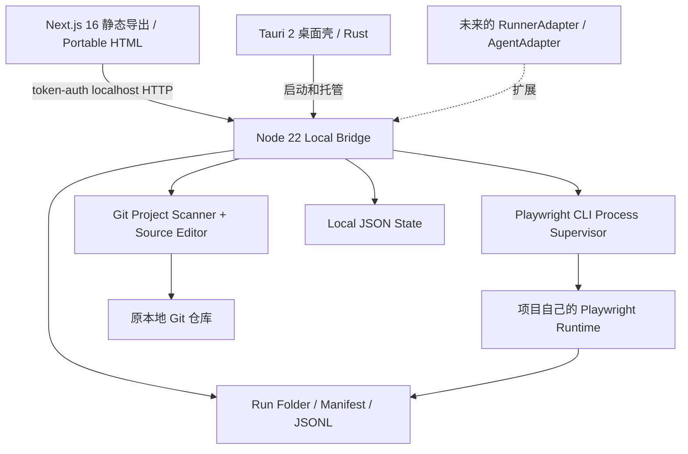

# ATS-BD-001 基本設計書

## 1. 系统结构

Tauri 的 Next.js 静态构建使用 `output: export`，不包含 Next.js API Routes/SSR。正式桌面部署的 Node sidecar 打包、安装、启动健康检查属于 P1 的发行工程；当前 Rust 壳为开发源代码。

## 2. 模块分解

| 模块 | 责任 | 当前具体实现 | 外部依赖 |
|---|---|---|---|
| B01 Project Catalog | 识别本地目录、Git 基线 | `validateProjectPath`, `gitInfo` | git CLI 可选 |
| B02 Test Index | 脚本扫描、测试定位 | `walkTests`, `discoverStatic` | 文件系统 |
| B03 Source Editor | 文件只读/受控写入 | `readSource`, `writeSource` | 文件系统 SHA-256 |
| B04 Execution Supervisor | 控制 Playwright 子进程 | `startRun`, `cancelRun` | 项目本地 CLI |
| B05 Event & Evidence | JSONL、summary、manifest、下载 | `writeEvent`, `finishRun`, `filesInRun` | 原生 reporters |
| B06 Presentation | 目录、图/代码、运行、需求、状态 | Next page/Portable HTML | Next/React 或纯浏览器 |
| B07 Graph Traceability | 需求/关联读取 | `/lineage` | `.aitest/*.json` |
| B08 AI Agent / Runner Plugins | 统一 Agent/Runner 协议 | 文档协议 | P1/P2 |

## 3. 信息流

`POST /projects` -> realpath/config validate -> `state.json` project index；`GET /tests` -> walk .spec/.test files -> titles + line positions -> UI；`PUT /source` -> hash compare -> write -> UI；`POST /run` -> create Run + spawn child -> stdout/log + JSON/HTML/Trace -> summarize + manifest -> UI download。

Run 创建后不会通过二次执行来恢复失败脚本；用户可再次触发新的 Run。Run 的历史相互隔离，源 Git commit 在开始运行时固定。

## 4. UI 画面结构

顶部：产品、环境、本地运行状态；项目栏：Git branch、commit、dirty、项目导入；左侧：四大导航（Catalog、Run、Traceability、Architecture）及资源清单；主内容：概览统计与工作区。代码和流程是统一源文件的两个视图，流程目前只读。

## 5. 数据分层

- **Git/原仓库**：Playwright `.spec`、配置、requirements、test design、traceability、政策（未来）。
- **Local State**：`~/.ai-test-studio/state.json`，项目索引与执行历史，不包含脚本正文。
- **Evidence**：`~/.ai-test-studio/runs/<run-id>/`，日志、事件、JSON/HTML/Trace 等，manifest 包含 SHA-256。
- **Secrets**：本版不提供集中存储和注入；应使用被测工程自己的安全配置。系统不收集 API Key。

## 6. API 总览

| URL | Method | 权限 | 用途 |
|---|---|---|---|
| `/api/health` | GET | public loopback | 版本与健康 |
| `/api/session` | GET | Origin allowlist | 本地会话 token |
| `/api/projects` | GET/POST | token | 列表/添加 |
| `/api/projects/:id/tests` | GET | token | 测试索引 |
| `/api/projects/:id/source?file=` | GET | token | 读取脚本 |
| `/api/projects/:id/source` | PUT | token | 乐观锁编辑 |
| `/api/projects/:id/run` | POST | token | 启动 |
| `/api/projects/:id/lineage` | GET | token | 需求关系 |
| `/api/runs` | GET | token | 历史 |
| `/api/runs/:id` | GET | token | 运行状态/日志 |
| `/api/runs/:id/stop` | POST | token | 停止 |
| `/api/runs/:id/events` | GET | token | 事件列表 |
| `/api/runs/:id/artifact?file=` | GET | token | 附件下载 |
| `/api/diagnostics` | GET | token | 运行限制/平台信息 |

## 7. 外部接口标准与扩展方式（P1）

RunnerAdapter：`discover(project, context) -> TestDefinition[]`、`start(spec, env) -> RunHandle`、`stop(runId)`、`collect(runId) -> EvidenceManifest`。ExplorerAgent：`plan(requirement, scope) -> TestIntent[]`、`observe(session) -> Observation`、`proposePatch(evidence) -> Diff`；Agent 不直接更新 Git。

**Agent 契约 v1 的实现状态（ATS-401）**：Agent 请求必须带作用域、预算与输入出处，产出为待审提案；Agent 不直接更新 Git 由**能力层**保证——写入与提交类能力在请求层被拒，契约层的源码不含任何文件写入、进程启动与网络访问调用（由静态检查守护；真正的运行时隔离属 ATS-403）。模型提供商接入（ATS-403）与 API Key 存储（ATS-402）尚未实现，仓库中不存在把模型输出写入仓库的代码路径。契约细节见 `docs/17-AGENT-CONTRACT.md`。

桌面 Runner 由 WDIO Tauri Service 实现，转换为共通 Execution/Attempt/Artifact 模型。Enterprise 接入远程 Runner 的消息携带 project UID、git sha、test UID、idempotency key、deadline、secrets reference，但不直接传项目本地绝对路径。

## 8. 设计要点与边界

可复用工作流模板应可版本化，不能把动态代码直接简化为一条静态图边；Run/Test/Attempt 需区分重试与重新运行；Evidence 是结果而非配置。目录结构和协议请参照详细设计与数据设计。
