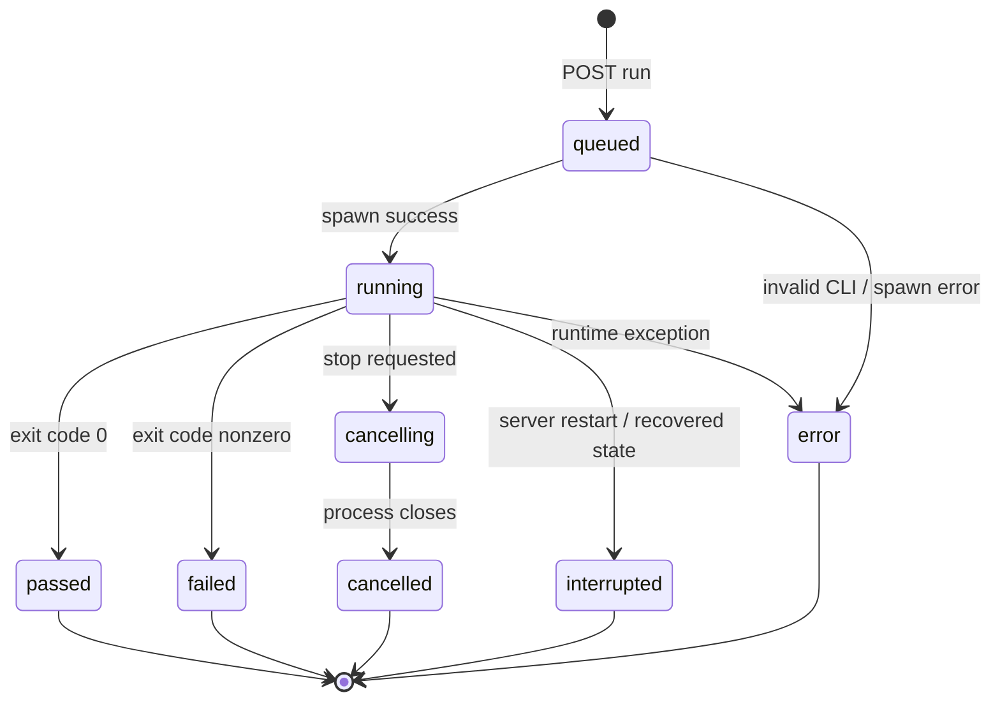

# ATS-DD-001 詳細設計書（实现范围与后继设计清晰分离）

## 1. 工程模块结构

```text
server/core.mjs        # 纯函数与本地文件/Git/报告处理
server/index.mjs       # HTTP API、会话、Runner 生命周期、文件下载
apps/studio/app        # Next.js App Router static export
apps/studio/lib/api.ts # UI 使用的统一 API Client
apps/studio/public     # 无 npm 依赖的便携 UI
src-tauri/src/lib.rs   # Rust 桌面壳，Node bridge 进程启动
```

## 2. URI、请求与响应

所有带状态 API 要求 `X-ATS-Token`；`/api/session` 必须在 localhost 或 tauri 来源访问，不接受陌生 Origin。Node 绑定 loopback `127.0.0.1:4577`，服务端校验 Host。所有错误返回 `{"error":"CODE"}`，不隐式安装或执行 npm 包。

```http
POST /api/projects
Content-Type: application/json
X-ATS-Token: <local token>

{"path":"D:\\Code\\MyWebApp"}

HTTP/1.1 201
{"project":{"id":"proj_uuid","name":"MyWebApp","root":"...","addedAt":"...","git":{"branch":"develop","commit":"abc123","dirty":false}}}
```

```http
POST /api/projects/:id/run
{"file":"tests/login.spec.ts"}  # null or omitted = all

HTTP/1.1 202
{"run":{"id":"run_uuid","status":"queued|running|error", ...}}
```

```http
PUT /api/projects/:id/source
{"file":"tests/login.spec.ts","content":"...","baseHash":"SHA256"}

HTTP/1.1 200
{"file":"...","hash":"new SHA256","changed":true}
```

## 3. 状态机



P0 实现是单项目至多一个并发 run；不同项目可同时执行。`runs` 写入 state 后再 spawn；退出事件在同一 Node 进程内串行处理。`events.jsonl` 记录 `run.queued`, `run.started`, `run.finished`, `run.cancelling`, `run.error` 等。对信号停止采取 best effort：Unix 直接 SIGTERM 子进程，Windows 尝试 `taskkill /T /F`；Unix 子进程后代清理仍有限制，因此长远需要进程组与沙箱。

## 4. Playwright 运行命令（无 shell）

```text
node <project>/node_modules/@playwright/test/cli.js test
  --reporter=line,json,html
  --output <ATS_DATA_DIR>/runs/<run>/results
  --trace on --screenshot only-on-failure
  --video retain-on-failure --workers 1
  [testFile]
```

环境 `PLAYWRIGHT_JSON_OUTPUT_FILE=<run>/report.json`、`PLAYWRIGHT_HTML_OUTPUT_DIR=<run>/html`、`PLAYWRIGHT_HTML_OPEN=never`。CLI 仅取自项目本地路径，不经 `npm exec`/`npx` 自动下载。Reporter 配置可能与目标工程现有 reporter 规则交互，ST 必须使用真实项目验证；不保证任意自定义项目可零配置运行。

## 5. 测试发现及脚本 ID

v0.1：`fs.readdirSync({withFileTypes:true})` 深度 14、最多 2000 文件，跳过 `.git,node_modules,dist,out,coverage` 等；从文件中识别常见 `test('literal')`/`it('literal')`。**脚本 ID 采用稳定 UID 规范 v1**（`docs/18-UID-SPEC.md`）：显式 `@TC-xxx` 标注优先（显式标注是作者的声明，注册表不得把它交给别的用例），其次按标题键或执行体指纹派生，无法唯一判定时给出临时标识并报告歧义；UID 在**文件改名后保持不变**，**标题改写后在执行体未变时保持不变**（靠 UID 注册表找回原 UID），同名用例改了执行体后 UID 会变（`describe` 路径不参与标题键，见 `docs/18-UID-SPEC.md` §7.1）。运行结果与用例的绑定同样有边界：同一文件里标题相同的用例靠**本次执行的源码**的执行体指纹区分，指纹算不出来时该次执行保持未绑定，不绑到别的用例；注册表的裁剪只针对「文件仍在本次发现范围内、但用例已消失」的条目，文件暂时缺席（例如切换分支）不会让用例丢掉 UID（见 `docs/18-UID-SPEC.md` §7.1）。

**P1 权威发现（v0.2.0 / ATS-202 已实现）**：`playwright test --list` 枚举出运行时真正会运行的用例，含动态生成与参数化用例；其身份阶梯、信任闸门与实测证据见 `docs/23-AUTHORITATIVE-DISCOVERY.md`。要点：

- **权威索引只对可信项目启用**。实测：`--list` 会加载项目配置并**执行测试文件顶层代码**，它不是只读操作；未可信仓库回退到静态索引并说明原因（`discovery: 'static'` + `authoritative.outcome`）。
- 权威发现下普通用例的 UID 与静态索引**一致**——在两个索引读到**同一个标题、同一个位置**时成立（见 `docs/23-AUTHORITATIVE-DISCOVERY.md` §4.5 的成立条件）；动态用例由 `describe` 路径判定（`uidBasis='scope-title'`）。
- 与 CLI 的一致性是**被度量的**：响应带 `consistency`，逐条报告只有一方可见的用例。

### P1 AST 子集

| 代码模式 | 目标节点 | 编辑许可 |
|---|---|---|
| `page.goto(url)` | Navigate | 静态 URL 可编辑 |
| `locator.click()` | Click | 简单 locator 可编辑 |
| `locator.fill(value)` | Input | 常量/引用可编辑 |
| `expect()` | Assertion | 限支持的 expect pattern |
| `test.step()` | Group | 折叠/展开 |
| helper / dynamic loop | CodeBlock | 仅在 Monaco 编辑，不做结构化反写 |

P1 变更流程：AST parse → calculate supported subset → generate JSON patch → print diff → syntax check → approve → atomic write → invalidate index。禁止 UI 自动修改业务断言的 expected 值。

## 6. 本地存储与 Evidence

`state.json` 包含 schema=1、projects、runs。每次更新先写临时文件再 rename；仅支持单本地服务进程。Run 文件目录包含 `stdout.log`, `events.jsonl`, `report.json`, `html/`, `results/**`, `manifest.json`。Manifest 保存 Evidence `file,size,sha256` 及 Git commit。下载前 realpath + isSubpath，目录跳转/软链接越界必须拒绝。

JSON report 中取 suite/spec/test/results，生成 `summary.total,passed,failed,flaky,skipped`；单个 case 包含 title,file,status,duration,error。外部 Playwright 状态 `expected` 映射 passed、`flaky` 映射 flaky、`skipped` 映射 skipped，其他状态映射 failed。聚合按多 project、retries 的高级统计为 P1。

## 7. 错误码和 UI 对策

| 错误码 | 来源 | HTTP | UI 行为 |
|---|---|---:|---|
| `PROJECT_PACKAGE_JSON_REQUIRED` | 未识别 package | 400 | 显示期望结构 |
| `PLAYWRIGHT_CONFIG_REQUIRED` | 缺 config | 400 | 提示设置项目 |
| `PROJECT_ALREADY_REGISTERED` | 重复 | 409 | 不重复登记 |
| `INVALID_SOURCE_FILE` | 源文件不是 spec/test | 400 | 不打开/不编辑 |
| `PATH_OUTSIDE_PROJECT` | 越界或符号链接 | 400 | 阻断、提示安全错误 |
| `STALE_EDIT_CONFLICT` | 源文件被外部更改 | 409（当前实现） | 提示重新加载并比较 |
| `PLAYWRIGHT_NOT_INSTALLED...` | 没有项目本地 CLI | 202 Run status=error | 提示项目中安装依赖 |
| `PROJECT_ALREADY_RUNNING` | 同项目并发 | 409 | 禁止重复启动 |
| `INVALID_SESSION` | 没有或错误 token | 401 | 重新访问本地会话 |
| `ORIGIN_NOT_ALLOWED` | 跨站 | 403 | 阻断 |
| `UNSUPPORTED_DATABASE` | state 版本错误 | 服务启动失败 | 手工备份/升级 |

注：`STALE_EDIT_CONFLICT` 根据通用错误映射为 HTTP 409。系统错误在 HTTP 500 可能包含异常消息，正式版应限制敏感信息显示。

## 8. 安全细则

运行不接受任意 cmd 字符串。`file` 必须是已存在的 `.spec/.test` 测试文件，真实路径在 project 目录内。浏览器不直接以未经授权的 URL 读取附件，附件必须带 token，且设 Content-Disposition attachment；静态资源不得提供仓库路径。服务器拒绝非 localhost Host。跨站访问 session 由 Origin allowlist 控制；同一用户下的其他本地进程仍可能访问服务，这不是操作系统级隔离。

## 9. P1 Runner / Agent 协议（Agent 契约 v1 已实现；Runner 适配器未实现）

```typescript
interface RunnerAdapter {
  kind: 'playwright' | 'wdio-tauri' | string;
  discover(project: ProjectRef): Promise<TestDefinition[]>;
  execute(input: {runId:string; testUid?:string; gitSha:string; workspace:string; envRef?:string}): AsyncIterable<ExecutionEvent>;
  stop(runId: string): Promise<void>;
  collect(runId: string): Promise<EvidenceManifest>;
}
interface AgentProposal { id:string; role:'planner'|'generator'|'triage'|'healer'; sources:string[]; actions:Action[]; patch:string; evidenceRefs:string[]; confidence?:number; approval:'pending'|'approved'|'rejected'; }
```

明确不在 P0 允许 AI 直接修改仓库。P1 工作流为 `proposal -> reviewer -> diff -> compile/tests -> human/policy approval -> Git`。

**Agent 契约 v1 的实现状态（ATS-401，S4/v0.4.0）**：`server/agent.mjs` 实现了 Agent 请求与提案的契约层——作用域（`scope`）、预算（`budget`）、输入出处（`inputs` 的 kind/ref/digest/content）、角色与能力白名单、提案收敛规则与评审状态机。契约层的权限边界是**机制**而非约定：契约层的源码只 import `node:crypto` 与 `node:path`、且不含任何 I/O 调用（由静态检查守护，**不是**「物理上无法」——真正的隔离属平台侧 ATS-403）；写入与提交类能力在请求层一律被拒；提案的 `approval` 恒为 `pending` 且提案人不得自审；diff 头部里出现的每一个路径都必须落在 `scope.outputs` 内且为测试脚本文件，rename/copy/binary/mode change 一律拒绝。

**未实现**：模型提供商接入（ATS-403）、API Key 存储与外传知情授权（ATS-402）、提案落地（应用 diff / 更新 expected / Git 提交）。仓库中**没有**把模型输出写入仓库的代码路径。详见 `docs/17-AGENT-CONTRACT.md`。
