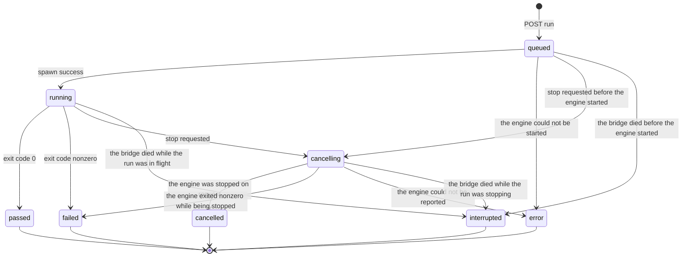

# ATS-DD-001 詳細設計書（实现范围与后继设计清晰分离）

## 1. 工程模块结构

```text
server/core.mjs        # 纯函数与本地文件/Git/报告处理
server/index.mjs       # HTTP API、会话、Runner 生命周期、文件下载
apps/studio/app        # Next.js App Router static export
apps/studio/lib/api.ts # UI 使用的统一 API Client
apps/studio/public     # 无 npm 依赖的便携 UI
src-tauri/src/lib.rs   # Rust 桌面壳，Node bridge 进程启动
```

## 2. URI、请求与响应

所有带状态 API 要求 `X-ATS-Token`；`/api/session` 必须在 localhost 或 tauri 来源访问，不接受陌生 Origin。Node 绑定 loopback `127.0.0.1:4577`，服务端校验 Host。所有错误返回 `{"error":"CODE"}`，不隐式安装或执行 npm 包。

```http
POST /api/projects
Content-Type: application/json
X-ATS-Token: <local token>

{"path":"D:\\Code\\MyWebApp"}

HTTP/1.1 201
{"project":{"id":"proj_uuid","name":"MyWebApp","root":"...","addedAt":"...","git":{"branch":"develop","commit":"abc123","dirty":false}}}
```

```http
POST /api/projects/:id/run
{"file":"tests/login.spec.ts"}  # null or omitted = all

HTTP/1.1 202
{"run":{"id":"run_uuid","status":"queued|running|error", ...}}
```

```http
PUT /api/projects/:id/source
{"file":"tests/login.spec.ts","content":"...","baseHash":"SHA256"}

HTTP/1.1 200
{"file":"...","hash":"new SHA256","changed":true}
```

```http
GET /api/projects/:id/env
X-ATS-Token: <local token>

HTTP/1.1 200
{"profiles":[{"uid":"env_1_...","name":"staging","environment":"staging",
              "variables":["BASE_URL","TENANT"],"variableCount":2,
              "createdAt":"...","updatedAt":"..."}],
 "environments":["dev","staging","prod"],
 "whitelist":{"names":["BASE_URL","TENANT"],"source":"default"}}
```

```http
POST /api/projects/:id/env
{"name":"staging","environment":"staging",
 "variables":{"BASE_URL":"https://staging.example","TENANT":"acme"}}

HTTP/1.1 200
{"profile":{"uid":"env_1_...","name":"staging","environment":"staging",
            "variables":["BASE_URL","TENANT"], ...}}
```

```http
POST /api/projects/:id/env
{"name":"bad","environment":"dev","variables":{"NOT_ON_THE_LIST":"x"}}

HTTP/1.1 400
{"error":"ENV_VARIABLE_NOT_ALLOWED",
 "rejected":[{"name":"NOT_ON_THE_LIST","reason":"the name is not on the environment whitelist of this project"}]}
```

```http
PUT /api/projects/:id/env-whitelist
{"names":["BASE_URL","TENANT"]}

HTTP/1.1 200
{"whitelist":{"names":["BASE_URL","TENANT"],"source":"custom"}}
```

```http
DELETE /api/projects/:id/env?ref=staging
X-ATS-Token: <local token>

HTTP/1.1 200
{"removed":"staging"}
```

```http
POST /api/projects/:id/run
{"file":"tests/login.spec.ts","env":"staging"}

HTTP/1.1 202
{"run":{"id":"run_uuid","status":"queued|running|error",
        "envUid":"env_1_...","envName":"staging","envTier":"staging",
        "envVariables":["BASE_URL","TENANT"], ...}}
```

环境档案相关的响应**只含变量名，不含值**（见 §5A.5）。运行引用不存在的档案时：

```http
POST /api/projects/:id/run
{"env":"no-such-profile"}

HTTP/1.1 404
{"error":"ENV_PROFILE_NOT_FOUND"}
```

## 3. 状态机



P0 实现是单项目至多一个并发 run；不同项目可同时执行。`runs` 写入 state 后再 spawn；退出事件在同一 Node 进程内串行处理。对信号停止采取 best effort：Unix 直接 SIGTERM 子进程，Windows 尝试 `taskkill /T /F`；Unix 子进程后代清理仍有限制，因此长远需要进程组与沙箱。

**本图与代码一致（ATS-208 第 2 轮复核修正）**：图上的每一条边都是
`server/execution/model.mjs` 的 `RUN_TRANSITIONS` 允许的迁移；反之，代码会
走到的迁移都在图上。上一版图与代码有五处不符：图上有而代码不会走的
`running → error`（引擎进程的 `error` 事件走 `finishRun(127)`，结果是
`failed`；`error` 状态只在**引擎还没起来**时出现，即 `queued → error`），
以及图上缺的四条边 `queued → cancelling`、`queued → interrupted`、
`cancelling → error`、`cancelling → interrupted`。

`RUN_TRANSITIONS` 还允许 `running → error` 与 `cancelling → error`；图中只画
了 `cancelling → error`（它是停止过程中引擎无法上报时的出口），
`running → error` 没有画出，因为**当前没有任何代码路径会产生它**：引擎进程
的 `error` 事件走 `finishRun(run, 127)`，终态是 `failed`。状态机是宽松的
（它只拒绝能被证伪的迁移），图画的是**实际会发生**的状态迁移。

**事件流（ATS-208 已实现）**：事件记录 `run.queued`, `run.started`, `run.cancelling`, `run.finished`, `run.error`, `run.interrupted`。三条性质是这条流的设计目标，定义在 `server/execution/model.mjs`：

1. **只追加**：事件永不重写；
2. **序号无空洞**：一个 run 的序号是 1..N，中间没有洞，所以读者能分辨「事件丢了」和「事件还没发生」；
3. **可复演**：把事件按序号折叠起来，得到 run 当时的状态——`GET /api/runs/:id/replay` 就是这个折叠。

实现上事件写在**状态变更之前**（`run.queued` 除外），于是事件流的最后一个事件决定终态；状态机会拒绝不可能的迁移并把拒绝记到 stderr，而不是默默写下一条与状态机矛盾的事件。Bridge 崩溃时写下 `run.interrupted`，因此被打断的 run 也能复演为 `interrupted`（此前它的事件流推不出任何状态）。事件的模型、Case/Attempt 的聚合规则与 SQLite 的 `events` 表见 `docs/06-DATA-DESIGN.md` §5.4。

**复演会校验状态机**：`GET /api/runs/:id/replay` 除了折叠出状态，还按
`RUN_TRANSITIONS` 逐条检查事件流，答案里带 `valid` 与 `violations`。一条违反
状态机的事件流（例如终态事件之后又追加了一条 `run.interrupted`）描述的是
一个从未存在过的 run，因此它**不得**报 `agrees: true`。

**恢复以持久日志为准**：Bridge 启动时读回每个 run 的 `events.jsonl`（日志是
记录，state.json 是它的缓存），并按下列规则处理：

- 日志里**已有终态事件**时，采用该终态，**不再追加任何事件**（终态事件之后
  追加事件会让事件流违反状态机）；
- 日志里没有终态事件、而 run 还停在 `queued` / `running` / **`cancelling`**
  时，写下 `run.interrupted` 并进入终态（`cancelling` 也在恢复集合里：Bridge
  在停止过程中死亡，那个 run 永远到不了终态，会一直占住项目的运行锁）；
- **日志缺失、不可读或尾行被撕裂**时降级：记录问题、run 仍恢复为终态、
  Bridge 照常启动（一个损坏的 run 不得拖垮整个安装）。

## 4. Playwright 运行命令（无 shell）

```text
node <project>/node_modules/@playwright/test/cli.js test
  --reporter=line,json,html
  --output <ATS_DATA_DIR>/runs/<run>/results
  --trace on --screenshot only-on-failure
  --video retain-on-failure --workers 1
  [testFile]
```

环境 `PLAYWRIGHT_JSON_OUTPUT_FILE=<run>/report.json`、`PLAYWRIGHT_HTML_OUTPUT_DIR=<run>/html`、`PLAYWRIGHT_HTML_OPEN=never`。CLI 仅取自项目本地路径，不经 `npm exec`/`npx` 自动下载。Reporter 配置可能与目标工程现有 reporter 规则交互，ST 必须使用真实项目验证；不保证任意自定义项目可零配置运行。

## 5. 测试发现及脚本 ID

v0.1：`fs.readdirSync({withFileTypes:true})` 深度 14、最多 2000 文件，跳过 `.git,node_modules,dist,out,coverage` 等；从文件中识别常见 `test('literal')`/`it('literal')`。**脚本 ID 采用稳定 UID 规范 v1**（`docs/18-UID-SPEC.md`）：显式 `@TC-xxx` 标注优先（显式标注是作者的声明，注册表不得把它交给别的用例），其次按标题键或执行体指纹派生，无法唯一判定时给出临时标识并报告歧义；UID 在**文件改名后保持不变**，**标题改写后在执行体未变时保持不变**（靠 UID 注册表找回原 UID），同名用例改了执行体后 UID 会变（`describe` 路径不参与标题键，见 `docs/18-UID-SPEC.md` §7.1）。运行结果与用例的绑定同样有边界：同一文件里标题相同的用例靠**本次执行的源码**的执行体指纹区分，指纹算不出来时该次执行保持未绑定，不绑到别的用例；注册表的裁剪只针对「文件仍在本次发现范围内、但用例已消失」的条目，文件暂时缺席（例如切换分支）不会让用例丢掉 UID（见 `docs/18-UID-SPEC.md` §7.1）。

**P1 权威发现（v0.2.0 / ATS-202 已实现）**：`playwright test --list` 枚举出运行时真正会运行的用例，含动态生成与参数化用例；其身份阶梯、信任闸门与实测证据见 `docs/23-AUTHORITATIVE-DISCOVERY.md`。要点：

- **权威索引只对可信项目启用**。实测：`--list` 会加载项目配置并**执行测试文件顶层代码**，它不是只读操作；未可信仓库回退到静态索引并说明原因（`discovery: 'static'` + `authoritative.outcome`）。
- 权威发现下普通用例的 UID 与静态索引**一致**——在两个索引读到**同一个标题、同一个位置**时成立（见 `docs/23-AUTHORITATIVE-DISCOVERY.md` §4.5 的成立条件）；动态用例由 `describe` 路径判定（`uidBasis='scope-title'`）。
- 与 CLI 的一致性是**被度量的**：响应带 `consistency`，逐条报告只有一方可见的用例。

### P1 AST 子集

| 代码模式 | 目标节点 | 编辑许可 |
|---|---|---|
| `page.goto(url)` | Navigate | 静态 URL 可编辑 |
| `locator.click()` | Click | 简单 locator 可编辑 |
| `locator.fill(value)` | Input | 常量/引用可编辑 |
| `expect()` | Assertion | 限支持的 expect pattern |
| `test.step()` | Group | 折叠/展开 |
| helper / dynamic loop | CodeBlock | 仅在 Monaco 编辑，不做结构化反写 |

P1 变更流程：AST parse → calculate supported subset → generate JSON patch → print diff → syntax check → approve → atomic write → invalidate index。禁止 UI 自动修改业务断言的 expected 值。

## 5A. 项目级环境档案与安全参数绑定（ATS-212，已实现）

### 5A.1 档案模型

环境档案是**项目级**的：档案属于一个项目，同名档案在另一个项目里是另一个档案。

| 字段 | 说明 |
|---|---|
| `uid` | `env_1_` + sha256(项目 UID + NUL + 名称) 的前 24 位。派生而非自增，所以同一项目同一名称永远是同一个档案 |
| `projectUid` | 所属项目 |
| `name` | 档案名（同一项目内唯一，不区分大小写） |
| `environment` | 层级，恰为 `dev` / `staging` / `prod` |
| `variables` | 变量名 → 值。**值只存在于档案自身** |
| `createdAt` / `updatedAt` | 创建与更新时间 |

项目与名称之间用 NUL 分隔：不分隔的话，`proj_1_aa` + `bc` 与 `proj_1_aab` + `c` 会哈希出同一个字符串。替换同名档案时 `uid` 不变，因此已引用它的运行仍指向同一个档案。

档案存放在 Bridge 状态里的 `state.envProfiles`，而不是单独一份文件：状态已经是真相源，原子写入、SQLite 镜像与导入导出往返都能覆盖它，另起一份旁路文件只会多一处会与状态分叉的地方。

### 5A.2 白名单：拒绝，而不是丢弃

变量名不在白名单上时，它**不入档案**，并连同**理由**一起报回调用方。静默丢弃会让调用方以为变量已生效——那是一个只会在生产里出现的 bug。

白名单条目只能是名称或**结尾单星号**（`FEATURE_*`）。通用 glob 不支持；裸 `*` 被拒——一个把范围写错的条目不该把白名单撑大到全体。

白名单按项目配置；未配置时用内置默认。配置的清单**替换**默认，不是叠加。

### 5A.3 凭据不进档案

名称呈凭据形态的变量（`*_TOKEN` / `*_PASSWORD` / `*_SECRET` / `*_API_KEY`，不区分大小写）一律被拒。

凭据形态的判定**先于**白名单判定：白名单从来就不是凭据能去的地方，把调用方指向白名单只会让它去错地方，所以理由直接指向凭据存储。

白名单本身也不能授权凭据形态的名称——配置这样的白名单会被整体拒绝且**不生效**（原白名单保持不变）。

保留名（`LD_PRELOAD` / `DYLD_INSERT_LIBRARIES` / `NODE_OPTIONS` / `PLAYWRIGHT_JSON_OUTPUT_FILE` 等）即使被白名单放行也拒绝。

**本任务不实现凭据存储。** 独立安全凭据存储是 FR-027 的另一半，不在 ATS-212 的范围内；这里做的是把凭据**挡在档案之外**，并说清它该去哪里。

### 5A.4 封口的 runner 环境

runner 子进程的环境是**封口**的：

```text
runner 环境 = 平台基础键 + 经白名单筛选的档案变量
```

宿主 `process.env` **一律不继承**。改造前适配器用的是 `{...process.env, ...}`，操作者在 shell 里的云凭据与 CI token 会一路进到被测代码，再被写进归档为证据的报告。

- 没有档案时环境同样封口（平台基础键仍在，子进程照样跑得起来）
- 平台关键键（`PATH` / `SystemRoot` / `ComSpec` 等）在构造环境时**无条件最后覆盖**，档案改不掉它
- 适配器自有的输出变量（报告写到哪里）也最后生效——引擎的契约是报告写在适配器指定的地方

### 5A.5 不进 Git

档案只落在 Bridge 的数据目录。项目目录**一个文件都不多**，档案的值不出现在项目树里的任何文件中。

API 响应、运行记录与 manifest 只带档案的 `uid` / `name` / `environment` 和变量**名**，不带值。

运行引用不存在的档案时返回 `404 ENV_PROFILE_NOT_FOUND`，**不静默降级**成「没有档案」——本该打 staging 的运行不能悄悄打了默认环境。

### 5A.6 SQLite

schema version 4，migration 4（`environment-profiles`）新增 `env_profiles` 表、`env_whitelists` 表与 `runs.env_uid` 列（additive，旧运行照旧）。

索引列只存变量**名**不存值，完整档案在 `doc` 列。镜像校验覆盖档案与白名单：缺档案、被篡改、索引列与记录矛盾、白名单不一致，都会被**报出来**而不是藏起来。

## 6. 本地存储与 Evidence

`state.json` 包含 schema=1、projects、runs。每次更新先写临时文件再 rename；仅支持单本地服务进程。Run 文件目录包含 `stdout.log`, `events.jsonl`, `report.json`, `html/`, `results/**`, `manifest.json`。Manifest 保存 Evidence `file,size,sha256` 及 Git commit。下载前 realpath + isSubpath，目录跳转/软链接越界必须拒绝。

JSON report 中取 suite/spec/test/results，生成 `summary.total,passed,failed,flaky,skipped`；单个 case 包含 title,file,status,duration,error。外部 Playwright 状态 `expected` 映射 passed、`flaky` 映射 flaky、`skipped` 映射 skipped，其他状态映射 failed。聚合按多 project、retries 的高级统计为 P1。

## 7. 错误码和 UI 对策

| 错误码 | 来源 | HTTP | UI 行为 |
|---|---|---:|---|
| `PROJECT_PACKAGE_JSON_REQUIRED` | 未识别 package | 400 | 显示期望结构 |
| `PLAYWRIGHT_CONFIG_REQUIRED` | 缺 config | 400 | 提示设置项目 |
| `PROJECT_ALREADY_REGISTERED` | 重复 | 409 | 不重复登记 |
| `INVALID_SOURCE_FILE` | 源文件不是 spec/test | 400 | 不打开/不编辑 |
| `PATH_OUTSIDE_PROJECT` | 越界或符号链接 | 400 | 阻断、提示安全错误 |
| `STALE_EDIT_CONFLICT` | 源文件被外部更改 | 409（当前实现） | 提示重新加载并比较 |
| `PLAYWRIGHT_NOT_INSTALLED...` | 没有项目本地 CLI | 202 Run status=error | 提示项目中安装依赖 |
| `PROJECT_ALREADY_RUNNING` | 同项目并发 | 409 | 禁止重复启动 |
| `INVALID_SESSION` | 没有或错误 token | 401 | 重新访问本地会话 |
| `ORIGIN_NOT_ALLOWED` | 跨站 | 403 | 阻断 |
| `UNSUPPORTED_DATABASE` | state 版本错误 | 服务启动失败 | 手工备份/升级 |
| `ENV_VARIABLE_NOT_ALLOWED` | 变量不在白名单 / 是凭据形态 / 是保留名 | 400 | 拒绝并给出理由（附 `rejected` 数组） |
| `INVALID_ENV_WHITELIST` | 白名单含凭据形态或非法名称 | 400 | 拒绝；原白名单保持不变 |
| `INVALID_ENV_PROFILE` | 档案缺名称 / 层级未知 | 400 | 拒绝并附 `problems` |
| `ENV_PROFILE_NOT_FOUND` | 运行引用了不存在的档案 | 404 | 不静默降级为「无档案」 |
| `ENV_PROFILE_REF_REQUIRED` | 删除档案时未给引用 | 400 | 要求给出档案名或 UID |

注：`STALE_EDIT_CONFLICT` 根据通用错误映射为 HTTP 409。系统错误在 HTTP 500 可能包含异常消息，正式版应限制敏感信息显示。

## 8. 安全细则

运行不接受任意 cmd 字符串。`file` 必须是已存在的 `.spec/.test` 测试文件，真实路径在 project 目录内。浏览器不直接以未经授权的 URL 读取附件，附件必须带 token，且设 Content-Disposition attachment；静态资源不得提供仓库路径。服务器拒绝非 localhost Host。跨站访问 session 由 Origin allowlist 控制；同一用户下的其他本地进程仍可能访问服务，这不是操作系统级隔离。

## 9. P1 Runner / Agent 协议（Agent 契约 v1 已实现；Runner 适配器未实现）

```typescript
interface RunnerAdapter {
  kind: 'playwright' | 'wdio-tauri' | string;
  discover(project: ProjectRef): Promise<TestDefinition[]>;
  execute(input: {runId:string; testUid?:string; gitSha:string; workspace:string; envRef?:string}): AsyncIterable<ExecutionEvent>;
  stop(runId: string): Promise<void>;
  collect(runId: string): Promise<EvidenceManifest>;
}
interface AgentProposal { id:string; role:'planner'|'generator'|'triage'|'healer'; sources:string[]; actions:Action[]; patch:string; evidenceRefs:string[]; confidence?:number; approval:'pending'|'approved'|'rejected'; }
```

明确不在 P0 允许 AI 直接修改仓库。P1 工作流为 `proposal -> reviewer -> diff -> compile/tests -> human/policy approval -> Git`。

**Agent 契约 v1 的实现状态（ATS-401，S4/v0.4.0）**：`server/agent.mjs` 实现了 Agent 请求与提案的契约层——作用域（`scope`）、预算（`budget`）、输入出处（`inputs` 的 kind/ref/digest/content）、角色与能力白名单、提案收敛规则与评审状态机。契约层的权限边界是**机制**而非约定：契约层的源码只 import `node:crypto` 与 `node:path`、且不含任何 I/O 调用（由静态检查守护，**不是**「物理上无法」——真正的隔离属平台侧 ATS-403）；写入与提交类能力在请求层一律被拒；提案的 `approval` 恒为 `pending` 且提案人不得自审；diff 头部里出现的每一个路径都必须落在 `scope.outputs` 内且为测试脚本文件，rename/copy/binary/mode change 一律拒绝。

**未实现**：模型提供商接入（ATS-403）、API Key 存储与外传知情授权（ATS-402）、提案落地（应用 diff / 更新 expected / Git 提交）。仓库中**没有**把模型输出写入仓库的代码路径。详见 `docs/17-AGENT-CONTRACT.md`。
