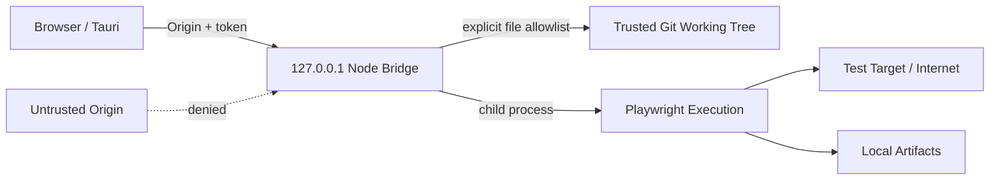

# ATS-SEC-001 セキュリティ設計・リスク評価

## 1. 信任边界

受信任：操作本地工作台的用户、Node Bridge 主进程、本地项目与操作系统当前用户。**不默认信任**：从互联网克隆的代码、任意网页、测试目标站点 DOM、LLM 输出、Trace/截图内容、外部工具与第三方依赖。v0.1 在**可信本地仓库**这一前提下运行：Playwright 启动测试时等同执行项目源代码，可能拥有宿主机用户权限。

## 2. 当前已有的控制

| 控制 ID | 措施 | 代码和限制 |
|---|---|---|
| SEC-001 | 仅 loopback 监听 | `server.listen(PORT,'127.0.0.1')`，不能直接远程访问 |
| SEC-002 | Host/Origin 限制 | Host=localhost/127.0.0.1 + allowlist；本地端口劫持未解决 |
| SEC-003 | 临时本地 Token | `/api/session` 为当前进程随机 token；同机其他进程可能访问 |
| SEC-004 | 文件路径规范化 | `realpath` + `isSubpath` + 文件后缀；拒绝 traversal/symlink |
| SEC-005 | 脚本更新冲突控制 | SHA-256 旧内容不匹配拒绝覆盖 |
| SEC-006 | 不接收任意 CLI 命令 | `spawn(process.execPath,args,{shell:false})` |
| SEC-007 | 附件隔离 | 每 Run 独立目录；附件下载 token 与 `Content-Disposition` |
| SEC-008 | 不自动向云端上传 | 无云账户/AI 服务自动调用；本机 UI/运行服务。**外传前必须先有覆盖该内容的知情授权**（ATS-402：预览范围 → 确认 → 授权记录；平台侧读真实文件并复算摘要，内容一变授权即失效——见 SEC-015） |
| SEC-009 | Agent 契约层无写入能力 | `server/agent.mjs` 只 import `node:crypto`/`node:path` 且源码不含任何 I/O 调用（静态检查守护）；写入与提交类能力在请求层被拒；提案 `approval` 恒为 `pending` 且提案人不得自审。**运行时隔离（模块沙箱/只读挂载/子进程）未实现，属 ATS-403** |
| SEC-010 | 插件契约层的权限边界 | `server/plugins/contract.mjs` + `server/plugins/sdk.mjs`：插件 Manifest **声明**权限，宿主按策略档位**授予**，生效集合 = 声明 ∩ 档位 ∩ 封闭词汇表；越权调用被拒且**被拒本身进审计**；**每一次 SDK 调用都留痕**（含宿主读取失败的那一次），审计序号**只在 sink 写入成功后**前进，因此与 sink 已写入的条数始终一致；插件作用域由宿主授予（Manifest 不带 scope），作用域有**文件前缀**与**允许的项目**两层，两层默认都为空；证据 SHA-256 由宿主 resolver 计算，插件不能自报；插件结论是提案（`approval` 恒为 `pending`）且提案人不得自审；**提案由 SDK 直接交给宿主，宿主持有权威记录**——宿主记录里没有的、字段或证据摘要与记录对不上的提案一律 `PLUGIN_PROPOSAL_INVALID`，`proposalId` 全局唯一，审计事件记 `proposalId` 与各证据摘要。**插件宿主与沙箱未实现，属 ATS-502/503/506 与 ATS-403**；同进程插件仍可自行 import I/O 模块，ATS-403 之前无保证 |
| SEC-011 | 权威发现的信任闸门（ATS-202） | `playwright test --list` **不是只读操作**：实测它加载项目配置（执行配置顶层代码）并**执行测试文件顶层代码**（`tools/ats202-probes/list-ground-truth.mjs` §6，33 项断言）。因此 `--list` 只在用户显式背书的**可信项目**上运行；未可信项目回退到静态索引并说明原因（`discovery: 'static'`、`authoritative.outcome: 'SKIPPED_UNTRUSTED'`），即使用户显式请求 `?authoritative=true` 也不执行。信任记录按项目 UID 持久化在 `state.json.trust`，可随时撤销。**沙箱化仍未实现：可信项目仍以宿主用户权限执行仓库代码，属 ATS-415** |
| SEC-012 | 环境变量白名单与凭据拒绝（ATS-212） | 档案按项目命名空间（`uid` 由项目+名称派生）；档案与白名单的写入/列举/删除/**运行**一律按 `projectKeyOf(project)`（= `project.uid ?? projectUidOf(project)`）取键（未迁移项目按其根目录重算出的 UID 与迁移后的新 `id` 相同，四个路径取到的键一致）；状态迁移同步改写 `envProfiles.profiles[].projectUid` 与 `envProfiles.whitelists` 的键，并按新键重新派生档案 `uid`、改写 `runs[].envUid`；变量名不在白名单上则**不入档案并连同理由报回**（不是静默丢弃）；同一请求里同一名字的两种大小写写法**整体拒绝**并报出两种写法（环境块不区分大小写，两者本就是同一个变量）；白名单条目只支持名称或结尾单星号，裸 `*` 被拒；名称呈凭据形态（`*_TOKEN`/`*_PASSWORD`/`*_SECRET`/`*_API_KEY`，不区分大小写）一律拒绝，且判定先于白名单（理由指向凭据存储而非白名单）；白名单本身也不能授权凭据形态的名称，配置这样的白名单被整体拒绝且不生效；保留名（`LD_PRELOAD`/`DYLD_INSERT_LIBRARIES`/`NODE_OPTIONS`/`PLAYWRIGHT_JSON_OUTPUT_FILE`/`PWDEBUG`/代理与 TLS 家族等）即使被白名单放行也拒绝，保留名比较**不区分大小写**；**空白名单 `names:[]` 就是空白名单**（按是否存在判断配置项，不按长度；允许清单为空就是什么都不允许）
| SEC-013 | runner 环境封口（ATS-212） | 子进程环境 = 平台基础键 + 经**当前**白名单筛选的档案变量，**不继承宿主 `process.env`**（操作者 shell 里的云凭据与 CI token 不会进到被测代码，也不会被写进归档为证据的报告）；没有档案时同样封口；**白名单约束的是运行而不只是写入**——收紧之后被移除的变量**过滤掉**、不再进入子进程，运行照常发生并只带仍被允许的变量，被过滤的名字与理由记在运行记录的 `envRefused`，`envVariables` 只列真正到达 runner 的名字；平台关键键在构造环境时无条件最后覆盖，档案改不掉它（先删掉结构键的**所有大小写变体**再按宿主拼写重新应用一次 —— Windows 环境块按字典序去重，不删变体就会让档案的 `WINDIR` 盖掉平台的 `windir`）；**保留名在运行时同样生效**——运行前按当前保留名单再筛一次，已存下档案里一个今天被保留的名字不会进入子进程；适配器自有的输出变量最后生效；**Windows 运行时会自动补入** `HOMEDRIVE`/`HOMEPATH`/`LOGONSERVER`/`SYSTEMDRIVE`/`USERDOMAIN`/`USERNAME`/`WINDIR`（非密钥，文档写明）；**环境封口不等于凭据隔离**——子进程同一用户身份运行且带 `HOME`/`USERPROFILE`，`~/.aws/credentials` 等照样可读，「宿主 secret 不到达被测代码」只成立于**环境变量层面**；**独立安全凭据存储未实现（属 FR-027 的另一半，不在 ATS-212 范围）：凭据形态的变量被拒并指向凭据存储** |
| SEC-014 | 环境档案不进 Git、不进公开元数据（ATS-212） | 档案只落在 Bridge 数据目录，项目目录一个文件都不多；API 响应、运行记录与 manifest 只带档案 `uid`/名称/层级与变量**名**，不带值；SQLite 的索引列也只存变量名（完整档案在 `doc` 列）；运行引用不存在的档案返回 404，**不静默降级**为「无档案」 |
| SEC-015 | 密钥用系统凭据库；外传需知情授权；越权外传被拦截并审计 | `server/security/credentials.mjs` + `server/security/egress-consent.mjs` + `server/security/egress-gate.mjs` + `server/security/egress-audit.mjs`：密钥**本体**只写系统凭据库（Windows Credential Manager 已实测；macOS Keychain / Linux Secret Service 代码已写、未实测），平台索引文件只存引用与 8 位指纹；秘密经 **stdin/stdout** 传给凭据库 helper，**不进 argv、不进日志**；**凭据库不可用即拒绝**（无明文回退）；外传三步为 `preview`（展示范围）→ `confirm`（携带一次性 previewId）→ `granted` 授权记录，范围摘要绑定内容，撤销即刻生效；**每一次外传判定都留痕**——放行与拒绝（含范围解析失败）都写入审计记录（`state.egressAudit`，拒绝类与决策类各 500 条、互不挤占），记录只含 ref/字节数/摘要（拒绝记录只含请求的 kind/ref），**不含内容、不含密钥**，追加写不可改写；preview / confirm / check 共用同一个范围解析器，`requirement` 与文件类输入都经 realpath 做根内判定。**未实现**：模型提供商接入（ATS-403）、macOS/Linux 后端未在真机实测、Tauri 壳内存取未验证、审计记录未做外部防篡改（本地高权限可改 `state.json`）、授权未绑定项目、未确认预览不过期——详见 `docs/23-AI-DATA-SECURITY.md` |

## 3. 不可忽略的剩余风险

| 风险 | 影响 | 等级 | P1 缓解 |
|---|---|---|---|
| 恶意测试脚本写/删宿主文件 | 极高 | HIGH | Docker/VM 只读 workspace、权限最小化、网络 allowlist |
| Tauri shell 与 Node bridge 尚未打包 | 无法直接商用发行 | HIGH | sidecar bundle + 签名 + 安装/升级策略 |
| session token 同机可请求；固定 4577 端口 | 其他同机进程干扰 | HIGH | IPC/Unix domain socket/named pipe、随机端口、OS 身份验证 |
| 测试报告含口令、PII、cookie | 泄露与隐私违规 | HIGH | 视觉脱敏、日志清洗、证据加密及保留期 |
| JSON 状态持久化未设置单写锁 | 多实例损坏或丢更新 | MEDIUM | SQLite WAL/文件锁/进程唯一实例 |
| 未签名 Evidence Manifest | 本地高权限可篡改 | MEDIUM | WORM、签名、远端哈希证明 |
| 依赖 lockfile 已生成，但 SPDX SBOM/漏洞扫描/许可证审核未做 | 供应链与发行风险 | MEDIUM | 依赖清单已生成（`docs/dependencies/`）；待补 SBOM + 漏洞扫描 + 许可证审核 |
| HTML 报告可能存在主动内容 | XSS/浏览器安全 | MEDIUM | 下载而不是在管理源直接执行 HTML |
| UI Monaco 编辑任意源码缺严格 diff 审批 | 人为误修改 | MEDIUM | Git diff review + code review policy |
| AI 自主修复更改 expected 导致掩盖 Bug | 测试完整性 | HIGH (P1) | 禁止无审批断言更新/必须重测/Reviewer 角色（Agent 契约 v1 已在能力层禁用 `update_expected`） |
| API Key 明文落盘或出现在进程表/日志 | 凭据泄露 | HIGH | ATS-402 已实现：系统凭据库 + 引用式落盘 + stdin/stdout 传密 + 无明文回退（SEC-015） |
| 项目内容在无知情授权的情况下被外传 | 隐私违规 | HIGH | ATS-402 已实现：外传前展示范围并确认，平台侧复算摘要，无授权即拒绝；放行与拒绝都进审计（SEC-008/SEC-015） |

## 4. 安全验收

ST-014/015/023 为当前最低安全实机验证。**ATS-402 新增 ST-031 / ST-032 / ST-033**（密钥入库后不出现在本机可读文件 / 首次外传前展示范围并确认 / 无授权的外传请求被拒）：ST-031、ST-033 已在真实浏览器里执行并 PASS；ST-032 的「触发外传」与「网络抓包」因仓库没有外发路径而 PENDING，见 `docs/23-AI-DATA-SECURITY.md` §5.5、§8。商业/企业发行额外要求：沙箱化执行、凭据保险箱、角色授权、网络分区、证据脱敏、SBOM、签名更新及渗透测试。**没有以上控制前，不能将工作台部署为公网远程服务**。
