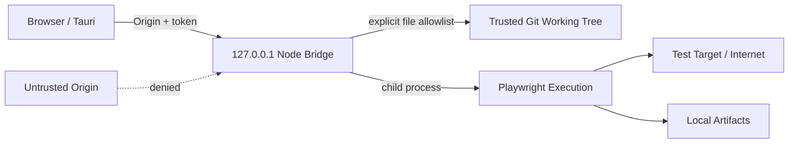

# ATS-SEC-001 セキュリティ設計・リスク評価

## 1. 信任边界

受信任：操作本地工作台的用户、Node Bridge 主进程、本地项目与操作系统当前用户。**不默认信任**：从互联网克隆的代码、任意网页、测试目标站点 DOM、LLM 输出、Trace/截图内容、外部工具与第三方依赖。v0.1 在**可信本地仓库**这一前提下运行：Playwright 启动测试时等同执行项目源代码，可能拥有宿主机用户权限。

## 2. 当前已有的控制

| 控制 ID | 措施 | 代码和限制 |
|---|---|---|
| SEC-001 | 仅 loopback 监听 | `server.listen(PORT,'127.0.0.1')`，不能直接远程访问 |
| SEC-002 | Host/Origin 限制 | Host=localhost/127.0.0.1 + allowlist；本地端口劫持未解决 |
| SEC-003 | 临时本地 Token | `/api/session` 为当前进程随机 token；同机其他进程可能访问 |
| SEC-004 | 文件路径规范化 | `realpath` + `isSubpath` + 文件后缀；拒绝 traversal/symlink |
| SEC-005 | 脚本更新冲突控制 | SHA-256 旧内容不匹配拒绝覆盖 |
| SEC-006 | 不接收任意 CLI 命令 | `spawn(process.execPath,args,{shell:false})` |
| SEC-007 | 附件隔离 | 每 Run 独立目录；附件下载 token 与 `Content-Disposition` |
| SEC-008 | 不自动向云端上传 | 无云账户/AI 服务自动调用；本机 UI/运行服务 |

## 3. 不可忽略的剩余风险

| 风险 | 影响 | 等级 | P1 缓解 |
|---|---|---|---|
| 恶意测试脚本写/删宿主文件 | 极高 | HIGH | Docker/VM 只读 workspace、权限最小化、网络 allowlist |
| Tauri shell 与 Node bridge 尚未打包 | 无法直接商用发行 | HIGH | sidecar bundle + 签名 + 安装/升级策略 |
| session token 同机可请求；固定 4577 端口 | 其他同机进程干扰 | HIGH | IPC/Unix domain socket/named pipe、随机端口、OS 身份验证 |
| 测试报告含口令、PII、cookie | 泄露与隐私违规 | HIGH | 视觉脱敏、日志清洗、证据加密及保留期 |
| JSON 状态持久化未设置单写锁 | 多实例损坏或丢更新 | MEDIUM | SQLite WAL/文件锁/进程唯一实例 |
| 未签名 Evidence Manifest | 本地高权限可篡改 | MEDIUM | WORM、签名、远端哈希证明 |
| 依赖 lockfile/许可证未做生成式 SBOM | 供应链与发行风险 | MEDIUM | CI SBOM + 漏洞扫描 + 许可证审核 |
| HTML 报告可能存在主动内容 | XSS/浏览器安全 | MEDIUM | 下载而不是在管理源直接执行 HTML |
| UI Monaco 编辑任意源码缺严格 diff 审批 | 人为误修改 | MEDIUM | Git diff review + code review policy |
| AI 自主修复更改 expected 导致掩盖 Bug | 测试完整性 | HIGH (P1) | 禁止无审批断言更新/必须重测/Reviewer 角色 |

## 4. 安全验收

ST-014/015/023 为当前最低安全实机验证。商业/企业发行额外要求：沙箱化执行、凭据保险箱、角色授权、网络分区、证据脱敏、SBOM、签名更新及渗透测试。**没有以上控制前，不能将工作台部署为公网远程服务**。
