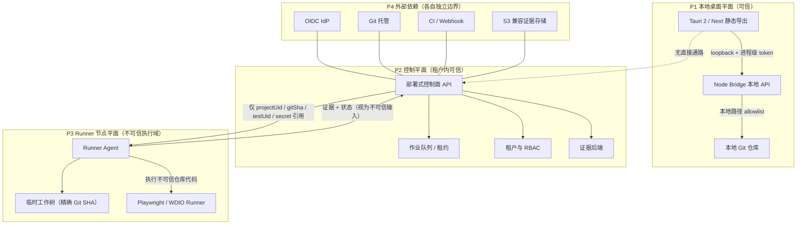

# ATS-RP-001 远程 Runner 协议与信任边界冻结（ATS-501 / S5 / v1.0.0）

- 冻结对象：AI Test Studio 的**远程执行面**（Remote Runner）——协议、信任边界、威胁模型与拒绝规则
- 冻结日期：2026-11-04；目标版本：v1.0.0（阶段 S5）
- 上游依据：`docs/02-REQUIREMENTS.md`（FR-028、FR-030）、`docs/03-BASIC-DESIGN.md` §1/§7、`docs/04-DETAILED-DESIGN.md` §3/§9、`docs/06-DATA-DESIGN.md`、`docs/11-SECURITY-RISK.md`、`docs/16-BASELINE-ADR.md`（ADR-005/006/009/013）、`docs/WBS.xlsx`「开发WBS」ATS-501 行
- 下游消费：ATS-502（队列/租约/幂等/重试）、ATS-503（节点注册与重连）、ATS-504（工作树/SHA/配额/清理）、ATS-505（CI 双向）、ATS-506（部署式 API 与本地 API 边界分离）、ATS-507（OIDC）、ATS-508（RBAC）、ATS-509（证据后端）、ATS-511（OpenAPI/Webhook）、ATS-512（插件 SDK）
- 机读校验：`tools/ats501-probes/audit-remote-protocol.mjs`（实际输出见 `docs/evidence/ATS-501/`）

## 1. 范围与状态声明

**本文件冻结的是协议，不是实现。** 远程执行面在 v0.1 与当前工作树中**不存在任何代码**：仓库内没有控制平面、没有 Runner 节点、没有远程作业队列。因此：

- 本文件全文的能力标记为 **DESIGNED**（已设计未实现），与 `docs/02-REQUIREMENTS.md` 中 FR-028 / FR-030 的 `DESIGNED` 标记一致；
- 不得在任何下游文档、发行说明或对外材料中把本协议的能力称为已实现；
- 本协议的实现分属上表所列 WBS，各项在自身完成前不得声称满足本协议；
- 唯一可执行的部分是**协议自身的机读校验**（§10 约束块 + `tools/ats501-probes/audit-remote-protocol.mjs`）：它校验本文件内部的一致性、约束块与正文表格的一致性、以及与 `docs/WBS.xlsx`、`docs/02-REQUIREMENTS.md`、`docs/16-BASELINE-ADR.md` 的交叉一致性。**它不验证任何远程运行时行为**——远程运行时目前不存在。

### 1.1 本文件覆盖与不覆盖

| 覆盖 | 不覆盖（另属其它 WBS） |
|---|---|
| 平面划分与信任边界（§2） | 桌面本地 Bridge 的进程管理、端口与握手（ATS-110/ATS-105） |
| 认证与凭据模型（§3） | OIDC 提供方实现、会话存储（ATS-507）；RBAC 判定与审计事件（ATS-508） |
| 协议版本握手与能力协商（§4） | Runner 插件 Manifest 与权限清单（ATS-512） |
| 租户隔离与存储前缀（§5） | 证据后端实现、生命周期策略（ATS-509）；元数据同步（ATS-510） |
| 拒绝码与拒绝策略（§6） | OpenAPI/Webhook 对外契约（ATS-511） |
| 作业消息语义（§7） | 队列实现、租约、心跳、重试（ATS-502） |
| 威胁模型（§8） | 渗透测试与整改（ATS-516） |

## 2. 信任边界

### 2.1 平面划分

远程执行引入四个互不信任的平面。**任何跨平面的调用都必须经过本协议定义的边界，不得由调用方直接触达。**



### 2.2 信任级别

| 平面 / 资产 | 信任级别 | 理由 | 本协议要求的处置 |
|---|---|---|---|
| P1 本地用户、操作系统账户、Node Bridge 进程 | **可信** | 与被测者同一主体，控制面不可直接触达 | 本地绝对路径只存在于 P1；不得跨平面传递 |
| P2 控制平面自身、租户内元数据 | **租户内可信** | 由本方运营 | 仍须校验一切来自 P3/P4 的输入 |
| P3 Runner 节点宿主、节点上的仓库代码 | **不可信** | 节点执行第三方仓库代码，等同在宿主上执行任意代码 | 节点须可抛弃；配额、时间与网络受限；秘密只以引用下发 |
| P4 外部 IdP / Git 托管 / CI / 对象存储 | **边界外依赖** | 由第三方提供 | 只信任其契约与签名；不承载明文秘密 |
| 节点回报的证据 `node_reported_evidence` | **不可信输入** | 由节点生成，内容由被测项目与互联网决定 | 控制平面侧一律做大小、类型、路径与配额校验 |
| 节点回报的 Git 元数据 `node_reported_git_metadata` | **不可信输入** | 由节点自报，可能与控制面记录不一致 | 与控制面持有的记录比对后再采信 |
| 仓库源码 `repository_source_code` | **不可信输入** | 被测项目内容 | 不得作为指令执行；不得让其自然语言驱动控制面决策 |
| 测试目标站点 DOM `test_target_dom` | **不可信输入** | 来自互联网 | 只作为证据数据存储，不参与控制面决策 |

### 2.3 硬边界规则（HB）

| 编号 | 规则 | 违反时的判定 |
|---|---|---|
| HB-1 | 控制平面**不得**直接调用 P1 的本地 API（`call_local_desktop_api`），也不得依赖 Tauri 特权 API 完成远程能力 | 设计缺陷，不得进入实现 |
| HB-2 | 跨平面消息**不得**携带本地绝对路径（`local_absolute_path`） | 拒绝 `REMOTE_PATH_FORBIDDEN` |
| HB-3 | 跨平面消息**不得**携带秘密明文（`secret_value`），只允许携带 secret 引用 | 拒绝 `REMOTE_SECRET_INLINE_FORBIDDEN` |
| HB-4 | 项目引用只使用不透明 UID（projectUid / testUid / runUid），**不得**用路径或仓库 URL 代替（`accept_local_path_as_project_ref`） | 拒绝 `REMOTE_PATH_FORBIDDEN` |
| HB-5 | Runner 节点与租户一对一绑定；一个节点在其生命周期内只服务一个租户 | 拒绝 `REMOTE_TENANT_MISMATCH` |
| HB-6 | 节点回报的证据、Git 元数据、日志一律视为不可信输入，不得因来自"我方节点"而免检 | 进入校验流水线后才可用 |
| HB-7 | 控制平面**不得**直接读取 Runner 节点文件系统（`read_runner_filesystem_directly`）；P1 本地能力与 P2/P3 能力必须在 API 层分离，不得共用同一凭据或同一端点 | 设计缺陷，归 ATS-506 |
| HB-8 | 远程执行路径必须复用与本地一致的 Runner 适配器契约（ATS-301），不得另起一套执行语义 | 设计缺陷，归 ATS-301/503 |

## 3. 认证

### 3.1 两类凭据，互不复用

| 主体 → 对端 | 凭据 | 获取 | 失效 | 约束 |
|---|---|---|---|---|
| 用户 → 控制平面 | OIDC 访问令牌（短期，JWT） | `ATS-507` 的 OIDC 登录 | 过期 / 撤销 | 角色与作用域由 ATS-508 判定；本协议只要求"未认证即拒绝" |
| Runner 节点 → 控制平面 | 节点凭据（Ed25519 私钥签名） | 一次性 enrollment token 换取 | 轮换 / 吊销 / 租户解绑 | 私钥存于节点 OS 密钥库（ATS-213/ATS-504）；不得出现在消息或日志中 |

**决策**：节点认证采用**一次性 enrollment token + Ed25519 请求签名**，不使用长期静态 bearer token，也不以 mTLS 为首要手段。理由：静态 token 一旦从节点泄露即可无限期冒用；签名可对每条请求绑定方法、路径、请求体摘要、时间戳与随机数，可独立吊销单个节点，且不要求控制面维护 CA 证书链。mTLS 作为部署形态的可选加固，不改变本协议的消息语义。

### 3.2 enrollment（节点入网）

1. 管理员在控制平面为某租户签发**一次性 enrollment token**：绑定 `tenantId`、限定用途 `node.register`、TTL 900 秒、可用次数 1。
2. 节点提交 enrollment 请求，附节点公开身份指纹（平台/OS/agent 版本）。
3. 控制平面校验 token 未过期、未使用、用途正确、租户有效；随后生成节点身份对并返回**私钥**（一次，仅此一次）。
4. 节点把私钥写入 OS 密钥库；控制平面只保留公钥。
5. enrollment token 立即失效；重复使用一律 `REMOTE_ENROLLMENT_TOKEN_INVALID`。

### 3.3 请求签名与防重放

节点发出的每条请求携带：`timestamp`、`nonce`、`signature = Ed25519(私钥, method || "\n" || path || "\n" || bodySha256 || "\n" || timestamp || "\n" || nonce)`。

控制平面校验：签名有效、`|now - timestamp| <= 60s`（时钟偏移容忍）、`nonce` 在 300 秒窗口内未出现过（重放拒绝）、节点状态为 `active` 且绑定租户与请求租户一致。任一不满足即拒绝并记审计事件。

### 3.4 传输与凭据卫生

- 控制平面与节点之间**必须**使用 TLS 1.3；明文传输一律拒绝，不得提供降级开关。
- 秘密只以**引用**下发（`secretRef`），由节点在执行期向密钥来源按需取用；控制平面不落库明文，节点不把明文写入日志、事件或证据。
- 节点凭据支持轮换：轮换期间新旧公钥并行有效，过渡窗口不超过 24 小时。
- 认证失败一律返回 `REMOTE_UNAUTHENTICATED` 或更具体的码，**不得**回显凭据内容，也不得回显"该节点存在但凭据错误"以外的节点存在性信息。

## 4. 版本握手

### 4.1 握手内容

节点注册或重连时提交：`protocolVersion`（`major.minor`）、`agentVersion`、`capabilities[]`（能力名列表）、`platform`、`osVersion`、`runnerKinds[]`（`playwright` / `wdio-tauri` / 其它）。

控制平面应答：`acceptedProtocolVersion`、`minMinor`（当前接受的最小 minor）、`requiredCapabilities[]`、`sessionId`、`leaseHeartbeatSeconds`、`sessionExpiresAt`。

### 4.2 兼容规则

| 规则 | 判定 | 结果 |
|---|---|---|
| **major 必须完全一致** | 节点 major ≠ 控制面 major | 拒绝 `REMOTE_PROTOCOL_MISMATCH`，不建立会话 |
| **minor 采用最小值约束** | 节点 minor < `minMinor` | 拒绝 `REMOTE_PROTOCOL_MISMATCH` |
| **minor 向上兼容** | 节点 minor > 控制面 minor | 接受，但节点**不得**使用超出已协商能力集的行为 |
| **能力按名协商** | 节点缺少 `requiredCapabilities` 中任一项 | 拒绝 `REMOTE_CAPABILITY_MISSING` |
| **能力集即上限** | 作业要求的能力不在已协商集合内 | 拒绝 `REMOTE_CAPABILITY_MISSING`，不得降级执行 |

**决策**：版本兼容**不靠版本号推断能力**，只靠**能力按名协商**。理由：minor 号不能可靠表达"节点是否支持某特性"，用能力名才能让新增特性在不升 major 的情况下落地；major 严格相等则保证消息语义不被误读。

### 4.3 握手与作业的关系

- 握手是**会话前置条件**：未完成握手的节点不会被派发任何作业。
- 会话与租约绑定：会话失效（心跳超时、租约过期）后，节点在重新握手前不得继续接收作业；控制平面把该节点的作业退回队列（ATS-502）。
- 握手结果持久化，节点重连时按同一 `protocolVersion` 协商；控制面 major 升级期间旧节点被明确拒绝，而不是静默降级。

## 5. 租户隔离

### 5.1 租户上下文来源

- `tenantId` **由服务端从会话推导**，客户端不得决定。请求携带租户上下文时，仅允许"与会话租户相同"，否则 `REMOTE_TENANT_MISMATCH`。
- 一切控制面资源（项目、作业、运行、证据、审计事件、订阅）都带 `tenantId`；**没有租户上下文的资源访问一律拒绝**（`REMOTE_TENANT_REQUIRED`），不得回退到"默认租户"。

### 5.2 标识符与路径

- 项目、测试、运行、证据一律用不透明 UID 引用；**不得**用仓库路径、仓库 URL、分支名作为跨平面的资源引用（HB-4）。
- 节点侧由 UID 解析到本地路径的映射只在节点内发生，且解析结果必须落在该节点的工作区根目录内；越界即失败（`REMOTE_PATH_FORBIDDEN`）。路径→UID 的解析归 ATS-504。

### 5.3 存储与访问隔离

| 项 | 规则 |
|---|---|
| 证据存储前缀 | `tenant/{tenantId}/{projectUid}/{runUid}/`，由后端适配器强制前缀（ATS-509） |
| 下载 | 短时效、租户绑定的签名地址；越租户访问一律拒绝 |
| 跨租户可见性 | **统一按 404 处理**（不区分"资源不存在"与"属于他租户"），避免存在性泄漏 |
| 审计事件 | 必须携带 `tenantId`；跨租户不可见；日志中租户标识不得与用户名组合成可识别个人的信息 |
| 本地↔远端同步 | 仅同步元数据与证据引用，不同步本地绝对路径（ATS-510） |

### 5.4 节点与租户

- 节点在 enrollment 时绑定一个租户，生命周期内不跨租户（HB-5）。
- 需要多租户时使用多个节点实例；**不**引入"超级节点"概念。

## 6. 拒绝规则

### 6.1 默认策略

**拒绝优先（deny-by-default）**：只有本节显式列出的条件才允许放行；未列举的条件一律拒绝，并记审计事件（附 `unhandledRejectionReason` 字段），**不得**按宽松默认放行。拒绝响应不得包含内部堆栈、宿主路径、节点指纹或其它租户的存在性信息。

拒绝码统一使用 `REMOTE_` 命名空间，与本地 Bridge 的错误码（`INVALID_SESSION`、`ORIGIN_NOT_ALLOWED`、`PROJECT_ALREADY_REGISTERED` 等）**不重名**，避免跨平面排障混淆。

### 6.2 拒绝码表

| 错误码 | HTTP | 触发条件 | 可重试 | 客户端可见信息 | 归属 |
|---|---|---|---|---|---|
| `REMOTE_UNAUTHENTICATED` | 401 | 缺少用户令牌 / 令牌无效或过期 / 节点凭据缺失 | 否 | 认证失败，需重新登录或重新入网 | ATS-507 |
| `REMOTE_SIGNATURE_INVALID` | 401 | 签名不匹配、随机数重放、时钟偏移超窗 | 否 | 节点签名校验失败 | ATS-503 |
| `REMOTE_ENROLLMENT_TOKEN_INVALID` | 401 | enrollment token 过期、已使用、用途不符或未知 | 否 | 入网凭据无效 | ATS-503 |
| `REMOTE_NODE_NOT_ENROLLED` | 401 | 节点身份未知或已吊销 | 否 | 节点未注册或已吊销 | ATS-503 |
| `REMOTE_PROTOCOL_MISMATCH` | 409 | 协议 major 不一致，或节点 minor 低于 `minMinor` | 否 | 协议版本不兼容 | ATS-503 |
| `REMOTE_CAPABILITY_MISSING` | 409 | 缺少必需能力，或作业所需能力不在已协商集合内 | 否 | 节点能力不满足作业要求 | ATS-301/503 |
| `REMOTE_TENANT_MISMATCH` | 403 | 请求租户与会话租户不一致，或节点绑定租户不一致 | 否 | 租户上下文不匹配 | ATS-508 |
| `REMOTE_TENANT_REQUIRED` | 403 | 缺少租户上下文 | 否 | 缺少租户上下文 | ATS-508 |
| `REMOTE_ROLE_FORBIDDEN` | 403 | 角色无权执行该操作 | 否 | 权限不足 | ATS-508 |
| `REMOTE_JOB_NOT_FOUND` | 404 | 作业不存在或不属于本租户 | 否 | 作业不存在 | ATS-502 |
| `REMOTE_JOB_NOT_LEASABLE` | 409 | 作业已被其它节点租用，或本节点不是租约持有者 | 是 | 作业当前不可派发 | ATS-502 |
| `REMOTE_LEASE_EXPIRED` | 409 | 租约已过期 | 是 | 租约已过期 | ATS-502 |
| `REMOTE_IDEMPOTENCY_CONFLICT` | 409 | 同一幂等键对应不同请求体 | 否 | 幂等键冲突 | ATS-502 |
| `REMOTE_QUOTA_EXCEEDED` | 429 | 超出并发、CPU、内存、磁盘或时长配额 | 是 | 超出资源配额 | ATS-504 |
| `REMOTE_RATE_LIMITED` | 429 | 超出速率限制 | 是 | 请求过于频繁 | ATS-502 |
| `REMOTE_PAYLOAD_TOO_LARGE` | 413 | 消息体超出上限 | 否 | 消息过大 | ATS-511 |
| `REMOTE_PATH_FORBIDDEN` | 422 | 消息中出现本地绝对路径、路径穿越或用路径代替 UID | 否 | 禁止传递本地路径 | ATS-504/506 |
| `REMOTE_SECRET_INLINE_FORBIDDEN` | 422 | 消息中携带秘密明文而非引用 | 否 | 禁止内联秘密 | ATS-504 |
| `REMOTE_GIT_SHA_INVALID` | 422 | 不是完整提交 SHA，或无法解析为可检出的提交 | 否 | Git SHA 非法 | ATS-504 |
| `REMOTE_TEST_UID_UNKNOWN` | 422 | 测试 UID 不存在或不属于该项目 | 否 | 测试标识未知 | ATS-201 |
| `REMOTE_WORKSPACE_DIRTY` | 409 | 工作树未处于请求的精确 SHA | 否 | 工作区状态不符 | ATS-504 |
| `REMOTE_EVIDENCE_CHECKSUM_MISMATCH` | 422 | 上传证据的 SHA-256 与声明不符 | 否 | 证据校验和不匹配 | ATS-509 |
| `REMOTE_RUNNER_UNREACHABLE` | 503 | 派发失败、连接中断或心跳超时 | 是 | 节点暂不可达 | ATS-502/503 |
| `REMOTE_INTERNAL` | 500 | 未列举条件（默认拒绝） | 是 | 服务端内部错误 | ATS-502 |

**幂等与状态类说明**：作业状态（`queued` / `leased` / `running` / `cancelling` / 终态）沿用 `docs/04-DETAILED-DESIGN.md` §3 的状态机语义，终态操作必须幂等（与 ATS-108/ATS-112 的修复口径一致）；`REMOTE_IDEMPOTENCY_CONFILICT` 只在"同键不同体"时出现，同键同体必须返回首次结果。

### 6.3 拒绝的可见性原则

| 原则 | 说明 |
|---|---|
| 不泄漏存在性 | 跨租户访问统一 404；不区分"不存在"与"属他租户" |
| 不泄漏内部结构 | 拒绝信息只给错误码与一句可行动提示；宿主路径、堆栈、节点指纹、数据库细节不出现在响应中 |
| 可行动 | 每个拒绝码对应一句客户端可执行的建议（重试 / 重新认证 / 升级 / 申请配额） |
| 可审计 | 每次拒绝产生一条审计事件：主体、租户、动作、错误码、目标资源 UID、时刻 |

## 7. 作业与消息协议

### 7.1 消息信封

所有控制平面 ↔ 节点消息使用统一信封：

```json
{
  "v": 1,
  "msgId": "msg_01J...",
  "tenantId": "ten_01J...",
  "type": "dispatch",
  "idempotencyKey": "idem_...",
  "deadline": "2027-11-10T09:00:00Z",
  "payload": { }
}
```

`payload` 中允许出现的字段仅限：`projectUid`、`gitSha`、`testUid`（数组）、`runnerKind`、`envRef`、`secretRefs`、`limits`（资源配额）、`reportSchemaVersion`。**不允许**出现：本地绝对路径、仓库 URL、分支名、秘密明文、宿主用户名（完整清单见 §9）。

### 7.2 方向与消息类型

| 方向 | 类型 | 语义 | 幂等要求 |
|---|---|---|---|
| 节点 → 控制面 | `register` / `reRegister` | 握手与能力协商（§4） | 按节点身份天然幂等 |
| 节点 → 控制面 | `heartbeat` | 保活与租约续期 | 按 `(nodeId, seq)` 幂等 |
| 节点 → 控制面 | `ack` | 接受作业并回报租约 | 必须带 `idempotencyKey` |
| 节点 → 控制面 | `progress` | 状态推进（不覆盖终态） | 按 `seq` 单调 |
| 节点 → 控制面 | `result` | 终态回报 | 必须带 `idempotencyKey` |
| 节点 → 控制面 | `evidence` | 证据上传（分片，带 SHA-256） | 按 `(runUid, file, sha256)` 去重 |
| 控制面 → 节点 | `dispatch` | 派发作业 | 必须带 `idempotencyKey` |
| 控制面 → 节点 | `cancel` | 请求停止 | 必须带 `idempotencyKey` |
| 控制面 → 节点 | `drain` | 停止接单、清理会话 | 幂等 |
| 控制面 → 节点 | `rotateCredentials` | 凭据轮换 | 幂等 |

### 7.3 幂等与重试

- `dispatch` / `cancel` / `result` 必须带幂等键。**同键同体**返回首次结果；**同键异体**拒绝 `REMOTE_IDEMPOTENCY_CONFLICT`。
- 重试由控制面发起，受 `deadline` 约束；节点不得在 `deadline` 之后仍回写终态（超时记为 `interrupted`）。
- 重试不得造成同一作业的重复执行副作用：节点按幂等键去重，命中已完成的作业直接回报原结果。

### 7.4 证据回流

节点上传的证据按 §5.3 的租户前缀落库；上传时校验大小与 SHA-256；**控制面不信任节点声明的 MIME 与扩展名**，按探测类型入库。证据可能含 PII 与秘密，责任与保留期归 ATS-509 与 ATS-516。

## 8. 威胁模型

分类按 STRIDE：欺骗 / 篡改 / 抵赖 / 拒绝服务 / 信息泄露 / 权限提升。威胁编号（TR-xx）在协议与实现中保持稳定。

| 编号 | 资产 | 分类 | 威胁 | 缓解措施 | 剩余风险 | 归属 | 验证方式 |
|---|---|---|---|---|---|---|---|
| TR-01 | Runner 宿主 | 权限提升 / 篡改 | 恶意仓库代码借执行逃逸到宿主读写文件、起进程 | 临时工作树固定到精确 SHA；工作区外路径不可达；CPU/内存/时长/磁盘配额；秘密只以引用下发；作业结束清理工作树 | 节点 OS 账户仍暴露于仓库代码 → 节点必须可抛弃、不得复用为其它用途 | ATS-504 | IT,ST |
| TR-02 | 租户边界 | 信息泄露 | 跨租户读取他人证据或元数据 | 服务端强制租户上下文；存储前缀强制；跨租户统一 404 | 存储后端自身缺陷可能绕过前缀 → 需后端侧校验与渗透测试 | ATS-509/508 | IT,ST |
| TR-03 | 节点凭据 | 欺骗 | 窃取节点私钥并冒用节点 | Ed25519 私钥存 OS 密钥库；一次性 enrollment；请求绑定时间戳与随机数防重放；可单独吊销 | 节点宿主被攻破时私钥仍可能被读取 | ATS-503/504 | IT |
| TR-04 | 秘密 | 信息泄露 | 明文秘密经消息、事件或证据外泄 | 消息只带 `secretRef`；内联明文一律拒绝；日志与事件禁止写秘密；证据入库前探测与清洗 | 被测项目自身把秘密写进 Trace/日志属项目责任，平台只能标注与告警 | ATS-504/516 | UT,IT |
| TR-05 | 仓库路径 | 信息泄露 | 本地绝对路径/仓库 URL 泄漏到云端 | 跨平面消息禁路径；项目只以 UID 引用；API 层对已知路径形态做拒绝 | 节点错误日志中偶然出现路径（节点侧日志脱敏要求） | ATS-504/506 | UT,IT |
| TR-06 | 协议语义 | 篡改 | 版本漂移导致消息被误解 | major 严格相等；minor 最小值约束；能力按名协商；握手为派发前置 | 控制面与节点实现不同步导致的中间态行为差异 | ATS-503 | IT |
| TR-07 | 作业额度 | 拒绝服务 | 重放或重复派发导致重复执行与额度虚耗 | 幂等键必填；同键异体拒绝；租约与心跳；`deadline` 强制终止 | 节点在幂等窗口外重启可能重复执行（须靠工作树幂等设计兜底） | ATS-502/504 | IT |
| TR-08 | 证据 | 篡改 | 证据被替换或篡改 | 上传校验 SHA-256；manifest 记录哈希；下载按租户前缀 | manifest 未签名，持有存储写权限者可同时改文件与 manifest | ATS-509/209 | IT,ST |
| TR-09 | 租户存在性 | 信息泄露 | 通过错误码差异探测他租户资源是否存在 | 跨租户统一 404；错误码不区分"不存在"与"属他租户" | 时序侧信道（响应时间差）未做规范化 | ATS-508 | UT,ST |
| TR-10 | 扩展面 | 权限提升 / 信息泄露 | 恶意插件请求超权、绕过审核与证据机制 | 插件 Manifest 声明权限；权限超出即拒绝；插件不得跳过审计与证据链路 | 第三方插件本身的行为 | ATS-512 | UT,IT |
| TR-11 | 节点资源 | 拒绝服务 | 超时作业不回收，节点被拖垮 | `deadline` 强制停止；租约过期回收；配额与速率限制；`drain` 指令 | 强制停止后子进程树回收依赖 ATS-108 的修复 | ATS-502/504/108 | IT,ST |
| TR-12 | 审计轨迹 | 抵赖 | 节点伪造时间戳或状态，掩盖失败 | 审计事件由控制面生成并以服务端时刻为准；节点时间仅作参考；事件追加不覆盖 | 控制面自身被攻陷 | ATS-508 | IT,ST |
| TR-13 | 本地/远程边界 | 权限提升 | 远程面借桌面特权 API 反向操作本机 | 本地 API 与远程控制面分离；远程面不依赖 Tauri 特权 API；本地凭据不进入远程消息 | 桌面应用同时装了本地与远程组件时的边界实现复杂度 | ATS-506 | IT |

### 8.1 未纳入本表的风险

| 风险 | 归属 | 说明 |
|---|---|---|
| AI 自主探索在远程节点上越权 | ATS-514 | 本协议只保证消息与凭据边界；探索行为本身另受 AI 权限模型约束 |
| 供应链（依赖、SBOM、许可证） | ATS-115/516 | 与远程协议无关，但节点镜像必须固定依赖版本 |
| 证据保留期与脱敏 | ATS-509/516 | 本协议只规定前缀与校验，不规定保留期 |

## 9. 跨平面数据约束

机读标记（backticked token）与 §10 约束块的 `boundary.forbiddenInMessages` 段一一对应；新增标记必须同时改两处。禁止项按消息方向分组。

| 方向 | 数据 | 允许形态 | 禁止（机读标记） |
|---|---|---|---|
| 控制面 → 节点 | 项目引用 | `projectUid` | 本地绝对路径、仓库 URL → `local_absolute_path` |
| 控制面 → 节点 | 代码版本 | 完整 Git SHA（40 位十六进制） | 分支名、浮动引用 → `branch_name`、`floating_ref` |
| 控制面 → 节点 | 测试选择 | `testUid[]`（稳定 UID，ATS-201） | 本地文件路径、临时索引 ID → `local_absolute_path` |
| 控制面 → 节点 | 秘密 | `secretRefs[]` | 明文值 → `secret_value` |
| 控制面 → 节点 | 环境 | `envRef` | 环境变量全量转储 → `secret_value` |
| 控制面 → 节点 | 租户上下文 | `tenantId`（会话推导） | 客户端指定或缺失租户 → `unscoped_tenant_id` |
| 控制面 → 节点 | 宿主标识 | 节点 `nodeId` | 宿主用户名、宿主凭据 → `runner_host_credentials` |
| 控制面 → 节点 | 资源配额 | `limits{ cpu, memory, disk, duration, concurrency }` | 无限制请求 → `unlimited_quota` |
| 节点 → 控制面 | 日志与报告 | 结构化事件 + 受限大小文本 | 无限长文本、宿主路径 → `local_absolute_path` |
| 节点 → 控制面 | 证据 | 按前缀 + SHA-256 的对象 | 未声明扩展名、目录穿越路径 → `local_absolute_path` |

## 10. 机读约束块（协议契约）

以下 JSON 块是本协议的**机读契约**：`tools/ats501-probes/audit-remote-protocol.mjs` 校验其不变量，并校验它与 §2/§3/§4/§5/§6/§9 正文**双向一致**。正文与约束块不一致即视为协议未冻结。修改协议时二者必须同改。

<!-- ats501-constraints -->

```json
{
  "protocol": {
    "name": "ats-remote-runner",
    "version": { "major": 1, "minMinor": 0, "negotiation": "capability_by_name" },
    "transport": { "tls": "1.3", "cleartextAllowed": false }
  },
  "authentication": {
    "userToControlPlane": "oidc_access_token",
    "nodeToControlPlane": "enrollment_token_then_ed25519_request_signature",
    "enrollmentToken": { "singleUse": true, "ttlSeconds": 900, "boundToTenant": true },
    "requestSignature": {
      "algorithm": "Ed25519",
      "covers": ["method", "path", "bodySha256", "timestamp", "nonce"],
      "replayWindowSeconds": 300,
      "clockSkewSeconds": 60
    },
    "nodeTenantBinding": "one_to_one"
  },
  "tenantIsolation": {
    "tenantSource": "server_assigned_from_session",
    "clientSuppliedTenant": "must_match_or_reject",
    "crossTenantResponse": 404,
    "storagePrefixTemplate": "tenant/{tenantId}/{projectUid}/{runUid}/",
    "resourceReference": "opaque_uid_only"
  },
  "boundary": {
    "planes": ["local_desktop", "control_plane", "runner_node", "external_dependencies"],
    "forbiddenInMessages": [
      "local_absolute_path",
      "secret_value",
      "runner_host_credentials",
      "unscoped_tenant_id",
      "branch_name",
      "floating_ref",
      "unlimited_quota"
    ],
    "untrustedInputs": [
      "node_reported_evidence",
      "node_reported_git_metadata",
      "repository_source_code",
      "test_target_dom"
    ],
    "controlPlaneMustNot": [
      "call_local_desktop_api",
      "read_runner_filesystem_directly",
      "accept_local_path_as_project_ref"
    ]
  },
  "rejection": {
    "namespace": "REMOTE_",
    "defaultPolicy": "deny",
    "unknownCondition": "reject_and_audit",
    "idempotentTerminalOperations": true,
    "codes": [
      { "code": "REMOTE_UNAUTHENTICATED", "http": 401, "retryable": false },
      { "code": "REMOTE_SIGNATURE_INVALID", "http": 401, "retryable": false },
      { "code": "REMOTE_ENROLLMENT_TOKEN_INVALID", "http": 401, "retryable": false },
      { "code": "REMOTE_NODE_NOT_ENROLLED", "http": 401, "retryable": false },
      { "code": "REMOTE_PROTOCOL_MISMATCH", "http": 409, "retryable": false },
      { "code": "REMOTE_CAPABILITY_MISSING", "http": 409, "retryable": false },
      { "code": "REMOTE_TENANT_MISMATCH", "http": 403, "retryable": false },
      { "code": "REMOTE_TENANT_REQUIRED", "http": 403, "retryable": false },
      { "code": "REMOTE_ROLE_FORBIDDEN", "http": 403, "retryable": false },
      { "code": "REMOTE_JOB_NOT_FOUND", "http": 404, "retryable": false },
      { "code": "REMOTE_JOB_NOT_LEASABLE", "http": 409, "retryable": true },
      { "code": "REMOTE_LEASE_EXPIRED", "http": 409, "retryable": true },
      { "code": "REMOTE_IDEMPOTENCY_CONFLICT", "http": 409, "retryable": false },
      { "code": "REMOTE_QUOTA_EXCEEDED", "http": 429, "retryable": true },
      { "code": "REMOTE_RATE_LIMITED", "http": 429, "retryable": true },
      { "code": "REMOTE_PAYLOAD_TOO_LARGE", "http": 413, "retryable": false },
      { "code": "REMOTE_PATH_FORBIDDEN", "http": 422, "retryable": false },
      { "code": "REMOTE_SECRET_INLINE_FORBIDDEN", "http": 422, "retryable": false },
      { "code": "REMOTE_GIT_SHA_INVALID", "http": 422, "retryable": false },
      { "code": "REMOTE_TEST_UID_UNKNOWN", "http": 422, "retryable": false },
      { "code": "REMOTE_WORKSPACE_DIRTY", "http": 409, "retryable": false },
      { "code": "REMOTE_EVIDENCE_CHECKSUM_MISMATCH", "http": 422, "retryable": false },
      { "code": "REMOTE_RUNNER_UNREACHABLE", "http": 503, "retryable": true },
      { "code": "REMOTE_INTERNAL", "http": 500, "retryable": true }
    ]
  },
  "job": {
    "idempotencyRequiredFor": ["dispatch", "cancel", "result"],
    "idempotencyConflict": "reject",
    "deadlineEnforced": true,
    "leaseRequired": true
  },
  "designStatus": "DESIGNED"
}
```

### 10.1 验收要素映射

| 完成定义中的验收要素 | 本文对应章节 | 机读约束键 |
|---|---|---|
| 服务端信任边界 | §2 | `boundary` |
| 认证 | §3 | `authentication` |
| 版本握手 | §4 | `protocol.version` |
| 租户隔离 | §5 | `tenantIsolation` |
| 拒绝规则 | §6 | `rejection` |

## 11. ADR 决策登记

| ADR | 决策 | 状态 | 理由 | 影响 |
|---|---|---|---|---|
| ADR-015 | 远程执行面与本地桌面面分离；跨平面消息禁止本地绝对路径，资源只以不透明 UID 引用 | ACCEPTED | 远程节点执行不可信代码，必须避免本地路径与凭据跨平面；与 ATS-506 的 API 边界分离一致 | 控制面 API 需新建，不复用本地端点；路径→UID 映射下沉到节点侧 |
| ADR-016 | 节点认证 = 一次性 enrollment token + Ed25519 请求签名（时间戳+随机数防重放）；静态 bearer token 与 mTLS 不作为首要手段 | ACCEPTED | 静态 token 泄露即可长期冒用；签名可单独吊销且不需 CA 链 | 节点需实现密钥库与签名；enrollment 流程新增一次性凭据分发 |
| ADR-017 | 协议 major 严格相等；minor 采用最小值约束；能力按名协商而非按版本号推断 | ACCEPTED | minor 号不能可靠表达特性支持；能力名协商允许不升 major 落地新特性 | 握手载荷增加能力清单；不兼容直接拒绝而非静默降级 |
| ADR-018 | 租户上下文由服务端从会话推导；存储按租户前缀隔离；跨租户访问统一按 404 处理 | ACCEPTED | 统一 404 避免存在性泄漏；前缀隔离让后端可强制 | 存储适配器须支持前缀强制；客户端不得自行指定租户 |
| ADR-019 | 拒绝优先：只放行显式列出的条件，未列举条件一律拒绝并记审计事件；拒绝码统一 `REMOTE_` 命名空间且不与本地码重名 | ACCEPTED | 放行默认会被新条件悄悄继承；命名空间隔离避免跨平面排障混淆 | 新增条件必须同步正文表格与机读约束块，否则机读校验失败 |
| ADR-020 | 幂等键为派发、取消与终态回报的强制字段；同键同体返回首次结果，同键异体拒绝 | ACCEPTED | 无幂等会重复执行并虚耗额度；同键异体不拒绝会造成语义歧义 | 队列与节点都要持久化幂等记录；重试策略需与之对齐（ATS-502） |

## 12. 与后续 WBS 的契约

| 下游 WBS | 本协议对其的约束 | 未满足时的表现 |
|---|---|---|
| ATS-502 队列/租约/心跳/幂等/重试 | 幂等键必填、`deadline` 强制、租约与心跳语义 | 作业重复执行、额度虚耗（TR-07） |
| ATS-503 节点注册与重连 | enrollment 流程、签名算法、握手载荷、版本兼容规则 | 节点无法入网或被误判为不兼容 |
| ATS-504 工作树/SHA/配额/清理 | 精确 SHA 引用、路径禁令、配额字段、清理与 `drain` | 不可信代码越权、路径泄漏（TR-01/TR-05） |
| ATS-505 CI 双向 | 幂等与终态回报语义 | 重复 webhook 造成重复作业 |
| ATS-506 部署式 API 与本地 API 边界分离 | HB-1/HB-7：不得仅依赖 Tauri 特权 API | 本地能力被远程面隐式依赖，安全边界失效（TR-13） |
| ATS-507 OIDC | 用户侧令牌语义与失效处理 | 认证绕过 |
| ATS-508 RBAC 与审计 | 拒绝码、跨租户 404、审计事件字段 | 越权访问、存在性泄漏（TR-02/TR-09） |
| ATS-509 证据后端 | 前缀模板、SHA-256 校验、类型探测 | 跨租户证据读取、证据被替换（TR-02/TR-08） |
| ATS-511 OpenAPI/Webhook | 消息信封与拒绝码必须进入对外契约 | 对外契约与内部协议漂移 |
| ATS-512 插件 SDK | 插件不得绕过审计与证据链路 | 插件越权（TR-10） |

## 13. 未验证项声明（PENDING ≠ PASS）

以下项目**未执行或不存在**，不得计入通过：

1. **远程执行面无任何实现**：控制平面、Runner 节点、远程队列在当前工作树中不存在，因此本协议的全部行为**未经运行时验证**。
2. **本文件唯一可执行的证据是协议自身的机读校验**：`tools/ats501-probes/audit-remote-protocol.mjs` 校验文档内部一致性与跨文档一致性，**不构成任何远程能力的实机证据**。
3. **威胁模型的缓解措施全部为设计**：TR-01~TR-13 的缓解列出的实现均归属其它 WBS，未实现、未测试。
4. **FR-028 / FR-030 仍为 `DESIGNED`**：`docs/02-REQUIREMENTS.md` 中二者未被修改，本协议不改变其状态。
5. **本地/远程 API 分离未验证**：HB-1/HB-7 的落地依赖 ATS-506。
6. **跨租户 404 掩码的时序侧信道未评估**（TR-09 剩余风险）。
7. **节点私钥在 OS 密钥库中的实际保护强度未评估**（依赖 ATS-213）。
