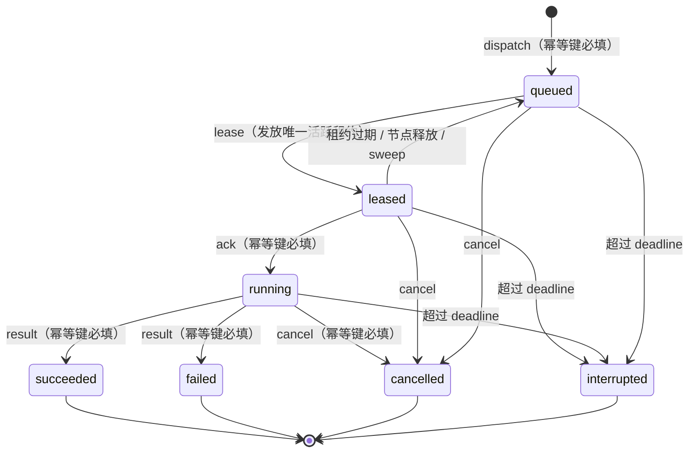

# ATS-SCH-001 远程调度服务（ATS-502 / S5 / v1.0.0）

- 冻结对象：AI Test Studio 远程执行面的**调度内核**——Job 队列、租约、心跳、幂等键、重试
- 状态：**PARTIAL**（调度语义已实现并实测；远程节点协议与执行仍未实现，见 §8）
- 上游依据：`docs/19-REMOTE-RUNNER-PROTOCOL.md`（ATS-501 冻结的协议，ADR-015~023）、
  `docs/04-DETAILED-DESIGN.md` §3（状态机）、`docs/02-REQUIREMENTS.md` FR-028
- 下游消费：ATS-503（节点注册与重连）、ATS-504（工作树/SHA/配额/清理）、
  ATS-505（CI 双向）、ATS-506（部署式 API 与本地 API 边界分离）
- 机读校验：`tools/ats502-probes/audit-scheduling-core.mjs`；负向夹具：`tools/ats502-probes/mutation-tests.mjs`
- 实现：`server/queue.mjs`（调度内核）、`server/scheduler.mjs`（调度服务 HTTP 面）

## 1. 范围与状态声明

**本文件描述的是已实现的代码，不是设计稿。** 与 ATS-501 不同（那份协议全部标记
`DESIGNED`），ATS-502 交付的调度内核**有可执行证据**：

| 能力 | 状态 | 证据 |
|---|---|---|
| Job 队列（入队/出队/状态机） | **IMPLEMENTED** | `tests/queue.test.mjs`、`tests/scheduler.test.mjs` |
| 租约（lease）与单一活跃租约 | **IMPLEMENTED** | 同上 |
| 心跳与租约续期 | **IMPLEMENTED** | 同上 |
| 幂等键（dispatch/ack/result/cancel） | **IMPLEMENTED** | 同上 |
| 重试（attempt 预算、退回队列） | **IMPLEMENTED** | 同上 |
| 租户隔离（租户由服务端绑定推导） | **IMPLEMENTED** | 同上 |
| 拒绝码表与 ATS-501 契约一致 | **IMPLEMENTED** | `tools/ats502-probes/audit-scheduling-core.mjs` |
| 节点签名 / enrollment / 握手 | **NOT IMPLEMENTED** | 属 ATS-503 |
| 工作树隔离 / 精确 SHA / 配额 | **NOT IMPLEMENTED** | 属 ATS-504 |
| 真实 Runner 执行 | **NOT IMPLEMENTED** | 属 ATS-301/504；本模块不 spawn 任何进程 |

**不得**把本文件的能力外推：调度内核已实现**不代表**远程执行已实现。FR-028 仍为
`DESIGNED`（`docs/02-REQUIREMENTS.md` §2），本任务不改变其状态。

## 2. 交付物与边界

### 2.1 两个文件，两个职责

| 文件 | 职责 | 不含 |
|---|---|---|
| `server/queue.mjs` | 调度内核：状态转换、不变量、幂等判定 | HTTP、认证、节点执行 |
| `server/scheduler.mjs` | 部署式调度服务的 HTTP 面 | 调度语义本身（在 `queue.mjs` 里） |

### 2.2 与本地 Bridge 的分离（ATS-501 HB-1 / HB-7）

`server/index.mjs`（本地桌面 Bridge）与 `server/scheduler.mjs`（部署式调度服务）
是**两个独立的服务**，不共享端口、token、路由表或凭据：

| 项 | 本地 Bridge（`server/index.mjs`） | 调度服务（`server/scheduler.mjs`） |
|---|---|---|
| 默认端口 | 4577 | 4580（`ATS_SCHEDULER_PORT`） |
| 凭据 | 进程级 token + Origin allowlist | 节点租户绑定（ATS-503 落地为请求签名） |
| 路由前缀 | `/api/projects`、`/api/runs` | `/api/scheduler/*` |
| 可见范围 | 本地可信仓库、单用户 | 租户内多节点 |

- **HB-1**：调度服务**不 import** 本地 Bridge，也不发起任何指向 `127.0.0.1:4577`
  的请求。控制平面不得直接调用 P1 的本地 API。
- **HB-7**：调度服务**不读** Runner 节点或本地任何文件系统（除自身队列的持久化
  文件），不把本地绝对路径当作资源引用。项目只以不透明 UID 引用。

这两条由 `tools/ats502-probes/audit-scheduling-core.mjs` 的边界检查**逐项机器复核**，
并由 `tools/ats502-probes/mutation-tests.mjs` 的负控证明这些检查会变红。

## 3. 作业状态机

ATS-501 §6.2 引入了 `leased` 中间态；`docs/04-DETAILED-DESIGN.md` §3 给出本地状态机。
远程作业的状态机是二者的并集：



### 3.1 终态只写一次

终态（`succeeded` / `failed` / `cancelled` / `interrupted`）是**吸收态**：

- 终态作业再收到 `result` → 返回既有终态结果，状态不变；
- 终态作业再被 `lease` → 拒绝 `REMOTE_JOB_NOT_LEASABLE`（**不是**静默返回
  成功——把「没有可执行的工作」藏进一个 200 是不诚实的）；
- 终态作业再被 `cancel` → 返回既有终态，状态不变。

这与 ATS-501 §6.2「终态操作必须幂等」一致。

### 3.2 attempt 与重试

每次 `lease` 成功开启一个新的 attempt（`job.attempt += 1`）。租约过期或节点释放时：

- 作业退回 `queued`，旧 attempt 在 `history` 里记为 `job.requeued`；
- **重投开启新 attempt，旧 attempt 的执行方失去租约**，因此它再回写终态会被拒
  （`REMOTE_JOB_NOT_LEASABLE`）——这是「断连重投不双跑」的关键；
- attempt 预算耗尽（默认 3 次）时作业记为 `failed` 终态，不再重投。

## 4. 三条验收不变量

### 4.1 断连重投不双跑

**规则**：一个作业在任一时刻至多有一个**活跃租约**。

| 场景 | 行为 | 拒绝码 |
|---|---|---|
| 已被节点 A 租用，节点 B 请求租用 | 拒绝 | `REMOTE_JOB_NOT_LEASABLE` |
| 节点 A 重复请求租用**自己的**作业 | 幂等：返回同一租约，attempt 不增加 | — |
| 租约过期后重新租用 | 允许；attempt +1；旧节点失去租约 | — |
| 旧节点在重新派发后回写终态 | 拒绝 | `REMOTE_JOB_NOT_LEASABLE` |
| 终态作业被租用 | 拒绝 | `REMOTE_JOB_NOT_LEASABLE` |

**证据**：`tests/queue.test.mjs` UT-QUEUE-040~045、`tests/scheduler.test.mjs`
IT-SCHED-009 / IT-SCHED-012。

### 4.2 心跳超时可恢复

**规则**：`heartbeat` 续租；租约过期时心跳被拒并把作业退回队列（未到 deadline）或
记为 `interrupted`（已到 deadline）。作业**不会**因为一次心跳超时而变成死路。

| 场景 | 行为 | 拒绝码 |
|---|---|---|
| 租约有效期内的心跳 | 续租，`heartbeatSeq` 单调递增校验 | — |
| 租约过期后的心跳 | 作业退回队列，拒绝 | `REMOTE_LEASE_EXPIRED` |
| 超过 deadline 的心跳（租约仍在） | 作业记为 `interrupted`，拒绝 | `REMOTE_LEASE_EXPIRED` |
| 心跳 seq 回退 | 拒绝 | `REMOTE_POLICY_REJECTED` |
| 节点会话失效（`releaseNode`） | 该节点名下作业全部退回队列 | — |
| 周期 `sweep()` | 回收过期租约与超期作业 | — |

**证据**：`tests/queue.test.mjs` UT-QUEUE-050~055、`tests/scheduler.test.mjs`
IT-SCHED-010 / IT-SCHED-011 / IT-SCHED-015。

### 4.3 重放结果幂等

**规则**：`dispatch` / `ack` / `result` / `cancel` 必填幂等键。

| 场景 | 行为 | 拒绝码 |
|---|---|---|
| 同键同体 | 返回**首次结果**，状态不变 | — |
| 同键异体 | 拒绝 | `REMOTE_IDEMPOTENCY_CONFLICT` |
| 同键 + 同体 + 同操作 + 同租户 | 幂等 | — |
| 同键跨租户 | 视为不同的键（键的作用域是租户） | — |
| 缺少幂等键 | 拒绝 | `REMOTE_POLICY_REJECTED` |

「同体」由**请求摘要**判定：`requestDigest()` 对请求的语义字段做稳定 JSON 序列化
（键按字典序）后取 SHA-256。因此字段的书写顺序不影响判定，而任何一个语义字段
的变化都会被认成「异体」。

**证据**：`tests/queue.test.mjs` UT-QUEUE-010~013 / UT-QUEUE-060~064、
`tests/scheduler.test.mjs` IT-SCHED-003 / IT-SCHED-004 / IT-SCHED-013。

## 5. 租户隔离

- 租户**由服务端从节点绑定推导**（ATS-501 §5.1）。`bindNode(nodeId, tenantId)`
  是控制平面侧的操作。
- 请求携带的 `tenantId` 必须与节点绑定一致，否则 `REMOTE_TENANT_MISMATCH`。
- 节点未绑定租户 → `REMOTE_TENANT_REQUIRED`。
- 一个节点在其生命周期内只服务一个租户（HB-5）；改绑被拒。
- 跨租户访问作业 → `REMOTE_JOB_NOT_FOUND`（404），不区分「不存在」与「属他租户」，
  避免存在性泄漏（ATS-501 §5.3 / TR-09）。

**边界声明**：ATS-508 负责完整的 RBAC 与审计事件；本任务只实现「租户由服务端
绑定推导 + 跨租户 404」这一层。

## 6. 拒绝码

调度服务**不使用**本地 Bridge 的错误码，也不发明新码：全部使用 ATS-501 §6.2 冻结的
`REMOTE_` 命名空间。`server/queue.mjs` 的 `REJECTION_CODES` 表与协议文档的机读约束块
**逐项一致**（同码、同 HTTP、同可重试性，无缺无多），这一点由
`tools/ats502-probes/audit-scheduling-core.mjs` 的 4 项检查复核，并由负控证明这些
检查会因任何漂移而变红。

| 拒绝码 | HTTP | 本模块中的触发场景 |
|---|---|---|
| `REMOTE_POLICY_REJECTED` | 403 | 缺幂等键、缺必填字段、非法枚举值、心跳 seq 回退 |
| `REMOTE_TENANT_REQUIRED` | 403 | 节点无租户绑定 |
| `REMOTE_TENANT_MISMATCH` | 403 | 客户端租户与节点绑定不一致；节点改绑 |
| `REMOTE_JOB_NOT_FOUND` | 404 | 作业不存在或不属于该租户 |
| `REMOTE_JOB_NOT_LEASABLE` | 409 | 已被租用、已终态、attempt 耗尽、非租约持有者回写 |
| `REMOTE_LEASE_EXPIRED` | 409 | 租约过期；超过 deadline |
| `REMOTE_IDEMPOTENCY_CONFLICT` | 409 | 同键异体 |
| `REMOTE_GIT_SHA_INVALID` | 422 | `gitSha` 不是 40 位十六进制 |
| `REMOTE_PAYLOAD_TOO_LARGE` | 413 | 请求体超限 |
| `REMOTE_INTERNAL` | 500 | 服务端内部错误（未预期异常） |

**`REMOTE_INTERNAL` 不是策略拒绝的兜底码**（ATS-501 §6.1）：策略拒绝不可重试，
内部错误可重试。调度服务因此不会把策略拒绝落到 500。

## 7. HTTP 接口面

```
GET    /api/scheduler/health                     队列快照
POST   /api/scheduler/jobs                       dispatch（202 新建 / 200 重放）
GET    /api/scheduler/jobs?tenantId=&state=      作业列表
GET    /api/scheduler/jobs/{jobId}               作业详情
POST   /api/scheduler/jobs/{jobId}/lease         租用
POST   /api/scheduler/jobs/{jobId}/heartbeat     心跳续租
POST   /api/scheduler/jobs/{jobId}/ack           接单确认
POST   /api/scheduler/jobs/{jobId}/result        终态回报
POST   /api/scheduler/jobs/{jobId}/cancel        取消
POST   /api/scheduler/jobs/{jobId}/sweep         回收过期租约与超期作业
POST   /api/scheduler/nodes/{nodeId}             绑定节点到租户
POST   /api/scheduler/nodes/{nodeId}/release     释放节点（作业退回队列）
```

响应体形状统一为 `{ job, replayed }` / `{ job, replayed, result }`；错误体为
`{ error: 'REMOTE_*', details? }`。

## 8. 未实现与未验证项（PENDING ≠ PASS）

以下项目**未实现或未验证**，不得计入通过：

1. **节点协议未实现**：请求签名、enrollment、握手、凭据轮换属 ATS-503。本模块只实现
   「租户由服务端绑定推导」这一最小可信部分；**任何节点的请求目前都未被认证**。
2. **执行未实现**：调度服务只把作业排进队列并发放租约，**不执行任何测试**。作业的
   终态由调用方回报，与真实 Runner 之间没有链路。
3. **工作树隔离 / 精确 SHA / 配额未实现**（ATS-504）：`gitSha` 只做了**形态**校验
   （40 位十六进制），不解析、不存在性校验、不对应任何工作树。
4. **证据回流未实现**（ATS-509）：作业结果里的 `payload` 不透明地保存，不做 SHA-256
   校验、不落证据存储、不做租户前缀强制。
5. **审计事件未实现**（ATS-508）：拒绝事件只通过 HTTP 状态与错误码体现，没有独立的
   审计事件流。
6. **持久化是单进程、非事务**：`JobQueue` 的落盘是「写临时文件 + rename」，但**没有
   跨进程写锁**（与 `docs/16-BASELINE-ADR.md` §7 第 7 条同源的限制）。多实例并发写
   同一队列文件未验证。
7. **长轮询 / 出站流未实现**（ATS-501 §2.4 冻结了「节点只出站」的方向）：调度服务
   现在是**请求/响应**模型，节点通过轮询取件。流协议形态归 ATS-502/503 的后续。
8. **无速率限制与并发配额**（`REMOTE_RATE_LIMITED` / `REMOTE_QUOTA_EXCEEDED` 在码表
   里，但本模块不产生它们）——配额归 ATS-504。
9. **真实浏览器链路未验证**：本任务不触发任何 Playwright/WDIO 执行。
10. **本地 Bridge 的既有缺陷不在本任务范围**：`tests/api.test.mjs` 的 IT-API-013 在
    本任务开始前即失败（干净树上同样失败），归 ATS-401/112。

## 9. ADR 决策登记

| ADR | 决策 | 状态 | 理由 | 影响 |
|---|---|---|---|---|
| ADR-024 | 远程调度语义（队列/租约/心跳/幂等/重试）实现为**独立模块** `server/queue.mjs`，部署式调度服务 `server/scheduler.mjs` 与本地 Bridge **不共享端口、凭据与路由** | ACCEPTED | HB-1/HB-7 要求 P1 与 P2/P3 能力在 API 层分离；共用一个端点会让远程面隐式依赖本地桌面能力（TR-13） | 远程面与本地面各自部署；ATS-506 可在此基础上继续分离 |
| ADR-025 | 幂等「同体」判定用**规范化 JSON 的 SHA-256 摘要**（键按字典序） | ACCEPTED | 字段书写顺序不应改变幂等判定；任何一个语义字段的变化都必须被认成异体 | 语义字段集合是契约的一部分，新增字段须同步进摘要输入 |
| ADR-026 | 租约过期后**重投开启新 attempt**，且旧 attempt 的执行方**永久失去**回写终态的权利 | ACCEPTED | 「断连重投不双跑」要求任何时刻只有一个执行方能写终态；否则旧节点恢复后会与新节点争写同一作业 | 旧节点的重试必须换幂等键（否则按「同键同体」视为重放） |
| ADR-027 | 超过 deadline 的作业**一律**记为 `interrupted` 终态，不再重投；deadline 优先于租约 | ACCEPTED | deadline 是协议规定的硬截止（ATS-501 §7.3）；把它让位给租约会让作业无限续命 | 调用方须为长任务设置合理的 deadline |
| ADR-028 | 终态作业被 `lease` 时**拒绝**（`REMOTE_JOB_NOT_LEASABLE`），而不是返回既有终态 | ACCEPTED | 把「没有可执行的工作」伪装成一个成功响应是不诚实的；ATS-501 §6.1 要求拒绝优先 | 调用方须区分「租到了」与「作业早已终态」 |

## 10. 与后续 WBS 的契约

| 下游 WBS | 本实现对其的约束 | 未满足时的表现 |
|---|---|---|
| ATS-503 节点注册与重连 | 节点租户绑定、租约续期、`releaseNode` 退回队列 | 节点无法入网；会话失效后作业滞留 |
| ATS-504 工作树/SHA/配额/清理 | `gitSha` 形态校验；`limits` 不在本任务范围 | 作业指向不存在的 SHA；配额无法强制 |
| ATS-505 CI 双向 | `dispatch` 的幂等键语义可承接重复 webhook | 重复 webhook 造成重复作业 |
| ATS-506 部署式 API 与本地 API 边界分离 | 本任务已分离端口/凭据/路由（HB-1/HB-7） | 远程面隐式依赖本地桌面能力 |
| ATS-507 OIDC / ATS-508 RBAC | 租户由服务端推导这一层已就位；用户侧令牌与审计事件未实现 | 越权访问与存在性泄漏 |
| ATS-509 证据后端 | 作业结果 payload 不透明保存 | 证据未经校验入库 |
