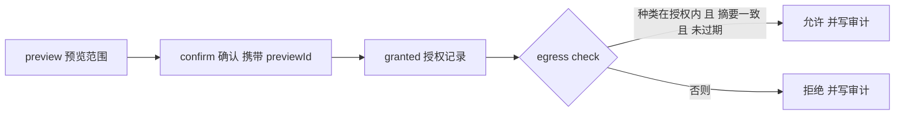

# ATS-402 ｜ AI 数据安全（AI API Key 存储、数据外传知情授权）

- WBS：ATS-402 ｜ 阶段 / 目标版本：S4 / v0.4.0 ｜ 工作流：安全 ｜ 主责：SecOps（安全与发布）
- 契约标识：`credential-store/v1` + `egress-consent/v1` + `egress-audit/v1` ｜ 实现载体：`server/security/`
- 关联要件：FR-027（多环境/密钥存储）、NFR-009（隐私保护）
- 前置依赖：ATS-401（AgentAdapter/ModelProvider 抽象及权限边界，已 `done`）
- 状态口径：本文件描述的是**已实现并经实测的凭据存储、外传授权与外传审计**。
  **模型提供商仍未接入**——仓库中没有任何代码把项目内容发往外部 AI 服务，
  因此本任务交付的是**三道闸门本身**，不是「AI 已经能读取你的项目」这一事实。

## 1. 交付范围与边界

| 属于 ATS-402（本次已实现） | 不属于 ATS-402（后续任务） |
|---|---|
| 密钥写入**系统凭据库**（Windows Credential Manager 已实测；macOS Keychain / Linux Secret Service 代码已写、**未实测**） | 模型提供商接入、重试与回退（ATS-403） |
| 引用式落盘：索引只存引用与指纹，秘密永不进文件 | 用密钥去调用真实模型（ATS-403） |
| 外传范围预览 → 确认 → 授权记录的三步知情授权 | Reviewer 界面与 diff 审阅 UI（P1） |
| **外传审计：放行与拒绝都留痕** | 跨设备同步、云端密钥托管（P2） |
| 平台侧复算内容摘要，且 preview / confirm / check 共用**同一个**范围解析器（补上 ATS-401 §6 的缺口） | 审计记录的外部防篡改（WORM/签名，见 §7） |
| AI 数据安全界面（Next 静态导出） | Tauri 壳内的凭据存取（属 ATS-104 的 B-02 链） |

**完成定义（验收标准）的落实**：**「密钥使用系统凭据库」**与**「首次上传任何项目
内容前展示范围并确认」**这两条**已成立并有实测证据**（§5）。其中「上传」在本仓库
里**没有真实的网络出口**（没有模型提供商），所以这条完成定义的**可检验部分**是
「**外传前必须先有覆盖该内容的知情授权，闸门在平台侧强制，越权外传被拦截并留下
可核对的记录**」——它由闸门代码、API 与 UI 三层共同保证，而不是靠一条约定。

## 2. 密钥存储：系统凭据库

### 2.1 三条硬规则

| # | 规则 | 落点 | 失效时的表现 |
|---|---|---|---|
| 1 | **秘密永不落盘** | `server/security/credentials.mjs` | 索引文件里只有 `{id,name,purpose,provider,fingerprint,createdAt,updatedAt}` |
| 2 | **秘密不进 argv、不进日志** | `server/security/wincred.ps1` | 秘密经 **stdin/stdout** 传给 helper 进程；helper 的 stderr 只写错误码 |
| 3 | **凭据库不可用就拒绝** | `createCredentialStore().put()` | 抛 `CREDENTIAL_STORE_UNAVAILABLE`；**没有明文文件后端** |

第 3 条是这套设计最容易做错的地方：一个「凭据库不可用就存到 `~/.secrets`」的
回退会把前两条规则悄悄作废。因此本实现**没有**任何回退后端——`selectBackend()`
在不认识平台上返回 `null`，而 `null` 后端意味着**拒绝**。

### 2.2 平台后端

| 平台 | 后端 | 秘密的传递方式 |
|---|---|---|
| Windows | Credential Manager（advapi32 `CredWriteW`/`CredReadW`） | `server/security/wincred.ps1`，经 stdin/stdout |
| macOS | Keychain（`security` 命令行工具）；**代码已写、未在真机实测** | `security add-generic-password -w` 省略 `-w` 的值时从 stdin 读 |
| Linux | Secret Service（`secret-tool`）；**代码已写、未在真机实测** | `secret-tool store` 从 stdin 读 |

Windows 的实现细节：`CredWriteW` 的 `CredentialBlob` 是**字节**长度，秘密按
UTF-16LE 写入；`Persist = CRED_PERSIST_LOCAL_MACHINE`（只对本机有效，不随域配置
漫游）。helper 脚本在 `finally` 里把秘密所在的**整块内存**（`CredentialBlobSize` 字节，
不只是第 1 个字节）清零后再释放。

macOS / Linux 后端经**注入的 `spawn`** 在任何平台上被单元测试驱动（UT-CRD-018/019：命令
形状、秘密只走 stdin、错误码规整），但这只证明**调用方式**，不证明真实 Keychain / Secret
Service 的行为。

### 2.3 指纹

引用里的 `fingerprint` 是秘密 SHA-256 的**前 8 个十六进制字符**。它的用途是让
用户核对「这是不是同一个密钥」，**不是**用来还原密钥——32 bit 的前缀不足以还原
任何有真实熵的密钥。它的存在使「界面上显示的密钥」与「凭据库里那个密钥」可以
被肉眼对齐，而不必把密钥原文取回浏览器。

### 2.4 写入的串行化与错误契约

- **put / remove 经由进程内互斥锁串行**，并在锁内**重新读取索引**：并发的同名 put 只有
  一个成功，其余是 `CREDENTIAL_DUPLICATE`；并发的不同名 put 全部保留引用；凭据库里不会出现
  没有引用的孤儿密钥（UT-CRD-002/003/004，IT-SEC-025）。索引写失败时，刚写进凭据库的秘密
  会被撤回。
- **`remove` 把凭据库里已不存在的条目当作成功**：目标状态「凭据库里没有它」已经成立，
  引用随之清掉；其它删除失败（例如权限）保留引用并报 `CREDENTIAL_STORE_FAILED`，因为
  秘密可能仍然存在（UT-CRD-005/006，IT-SEC-026）。
- **后端错误一律规整进 `CREDENTIAL_ERROR_CODES`**：词汇表之外的码（例如 helper 报的
  `CREDENTIAL_WRITE_FAILED`）归为 `CREDENTIAL_STORE_FAILED`，HTTP 为 **503**（UT-CRD-007/013，
  IT-SEC-026）。
- Windows helper 在**没有给出任何 `CREDENTIAL_*` 码**就退出时（PowerShell 宿主或内联 C#
  编译的瞬时失败）重试一次；带码的失败是确定性的，不重试（UT-CRD-017）。

## 3. 数据外传知情授权

### 3.1 三步流程



**为什么「确认」必须携带 `previewId`**：如果确认只是一个布尔值，用户确认的
范围与实际外传的范围可以是两份不同的东西——预览就成了走过场。因此：

- `previewId` 是一次性的，确认后立即作废（重复确认 → `EGRESS_PREVIEW_INVALID`）；
- 确认时**重新**计算范围摘要，与预览时的不一致 → `EGRESS_PREVIEW_STALE`；
- 授权记录里存的是**范围摘要**（种类 + ref + 内容摘要），不是内容本身。

### 3.2 授权的有效期与撤销

默认 24 小时，上限 365 天。过期后 `check()` 返回 `EGRESS_CONSENT_EXPIRED`；
`GET /api/security/egress/consents` 返回的 `state` **反映过期**（`granted` / `revoked` /
`expired`），界面据此不把过期授权算进「有效授权」，也不提供撤销按钮（UT-CON-001、IT-SEC-023、
UI-EXPIRED）。
撤销立即生效（`DELETE /api/security/egress/consents/:id`），撤销后的下一次
`check()` 返回 `EGRESS_CONSENT_REVOKED`。

### 3.3 判定顺序：先判定，后读取

平台侧的闸门（`server/security/egress-gate.mjs`）**先**问「这份同意书还有效吗、
它允许这些种类吗」，**再**读文件、复算摘要，**最后**问「内容与用户当时看到的
是同一份吗」。因此**没有授权时，文件内容根本不会被读进 Bridge 的内存**。

### 3.4 平台侧复算摘要（补上 ATS-401 §6 的缺口）

`docs/17-AGENT-CONTRACT.md` §6 的「未实现与后续」表里有一行：

> | 「`ref` 对应真实源内容」的构造 | ATS-402 / 平台侧 |
> | 本层只保证「摘要与内容自洽」且「`ref` 在作用域内」。平台侧读取真实文件并计算摘要的代码路径尚未实现 |

本任务的 `resolveEgressInputs()` 就是那条代码路径，而且它是**范围解析的唯一实现**：
preview（用户看到的范围）、confirm（用户同意的范围）与 check（闸门放行的范围）三处
都经由它，所以三者不会漂移。它按输入种类解析：

| 种类 | 解析为 | 说明 |
|---|---|---|
| `file` / `evidence` | `<项目根>/<ref>` | realpath 后仍须在项目根内 |
| `requirement` | `<项目根>/.aitest/<ref>`（缺省 `requirements.json`） | realpath 后须在 `.aitest` 内 |
| `run` | 注入的 `runResolver(ref)` | 内容是平台自己的运行记录摘要 |

读真实文件、用**平台侧的** SHA-256 复算摘要。于是「`ref` 对应真实源内容」这条保证
不再依赖请求方声明（UT-GATE-001，IT-SEC-019/020）。

路径校验与 ATS-101 的 SEC-004 同一口径：绝对路径与 `C:` 盘符一律拒绝；
符号链接 / junction 指向项目外时，**realpath 之后**的路径仍须在项目根之内
（`requirement` 须在 `.aitest` 之内）（UT-GATE-002/003，IT-SEC-021/022）。

`/check` 里范围解析失败（越界、输入畸形、未知项目）**不是异常，而是一次拒绝**：闸门返回
带错误码的拒绝，调用点写 `egress.denied` 审计（见 §4）。

## 4. 外传审计

完成定义的第三条是「**越权外传被拦截并审计**」。拦截由闸门负责（§3），审计由
`server/security/egress-audit.mjs` 负责，两件事分开：只有拦截没有留痕，
「被拒绝了」这句话就没有可核对的依据。

| # | 规则 | 落点 |
|---|---|---|
| 1 | **成功与失败都记录** | `egress.granted` / `egress.denied` / `consent.granted` / `consent.revoked` 四类事件 |
| 2 | **记录永远不含内容** | 记录只有 `ref`、`digest`（内容 SHA-256）与字节数；`content` 与 `preview` 在**边界上**被丢弃，下游拿不到 |
| 3 | **追加写，不改写** | 撤销授权不会抹掉「曾经放行过」的记录——审计记录是**事实**，不是状态 |
| 4 | **有上限，且按类别计数** | 拒绝类（`egress.denied`）与决策类（`egress.granted`、`consent.*`）各 500 条，超出后各自丢**本类**最旧的（写在代码里，不靠外部配置） |
| 5 | **每一次拒绝都记录** | `/check` 里所有拒绝都写 `egress.denied`，包括闸门抛出的范围失败（SCOPE_INVALID / INPUT_INVALID / PROJECT_UNKNOWN）；记录带请求方给出的 kind/ref，**不读文件、没有摘要**（`digest:null`、`bytes:0`） |

记录持久化在 `state.json` 的 `state.egressAudit`；跨 Bridge 重启保留（IT-AUD-004）。
授权与它的审计记录是**两次**相邻的 `saveState`（confirm 先写授权、后写审计），审计写入
失败会把异常抛给调用方，不会被吞掉。

**保留策略**：审计轨迹不会被同一个 API 冲掉——拒绝再多也只淘汰更旧的拒绝记录，放行与
授权记录不受影响（UT-AUD-009/010）。决策类自己的上限（500 条）是**有意的容量边界**：到达上限后
丢本类最旧的一条，超出该窗口的历史需要外部归档（见 §7）。

**审计不是防篡改存储**：记录在本地 `state.json` 里，本机高权限进程仍可改写。
「不可篡改的审计」需要 WORM/远程归档/签名，不在本任务范围（见 §7）。

## 5. 实测证据

所有日志在 `docs/evidence/ATS-402/`，每份日志带 commit、时间戳、Node/Python
版本与实际命令。

### 5.1 单元测试（UT）

| 文件 | 内容 | 结果 | 日志 |
|---|---|---|---|
| `tests/security.test.mjs` | 凭据库、授权、审计的基础行为 | **41 项 / 41 通过 / 0 失败 / 0 跳过** | `01-security-ut.log` |
| `tests/security-credentials.test.mjs` | **注入凭据库**与注入 `spawn` 的凭据存储：并发、NOT_FOUND、错误码规整、三个平台后端 | **20 项 / 20 通过** | `01b-credentials-ut.log` |
| `tests/security-gate.test.mjs` | 闸门（单一解析器、越界、junction）、授权列表的过期状态、审计分类上限 | **15 项 / 15 通过** | `01c-gate-audit-ut.log` |

这三个文件**不启动 Bridge 子进程**，因此覆盖率不依赖子进程统计。

### 5.2 覆盖率（`server/security/**`，行覆盖率须**严格大于** 90%）

`01d-security-coverage.log`（`node --test --experimental-test-coverage`，只含进程内测试）：

| 文件 | 行 % | 分支 % | 函数 % |
|---|---|---|---|
| `credentials.mjs` | **97.57** | 92.26 | 97.01 |
| `egress-audit.mjs` | **98.97** | 86.36 | 92.86 |
| `egress-consent.mjs` | **92.16** | 83.33 | 90.48 |
| `egress-gate.mjs` | **98.44** | 96.39 | 100.00 |
| 合计 | **96.50** | 90.68 | 95.50 |

`buildEgressScope` 不再是死代码：它是 `resolveEgressInputs` 的薄封装，被 `server/index.mjs`
的 preview / confirm 使用（UT-GATE-001）。

### 5.3 集成测试（IT）

`node --test tests/security-api.test.mjs`：**32 项**（含启动与清理两个夹具项）。

- 不带真实凭据库：28 通过、**4 跳过**、0 失败（`02-security-api-it.log`）。四项跳过的是
  **需要写真实凭据库**的用例（IT-SEC-004/005/025/026）。
- `ATS402_REAL_CREDENTIAL_STORE=1`：**32 项全通过，0 跳过**（`03-security-api-it-real-store.log`），
  写的是**真实的 Windows Credential Manager**。

> **跳过不等于通过**：两份日志都保留，正是为了不让「跳过」把「通过」盖住。

IT 覆盖：契约端点、端点需要会话令牌、凭据清单只含引用、**秘密不出现在平台数据目录的任何
文件里**、重名即拒、非法名即拒、预览展示真实范围、**无授权外传被拒（403）**、
preview→confirm→check 放行、预览令牌不可复用、无预览的确认被拒、内容在确认后变化即被拒、
撤销后立即被拒、越界路径被拒、未知项目、授权记录不含内容、诊断端点、非安全类错误保持
ATS-402 之前的行为；审计侧：拒绝留痕、放行也留痕、记录不含内容、跨重启保留；以及：

- **IT-SEC-019/020**：`requirement` 与 `run` 输入各走完 preview→confirm→check，结果 **200**；
- **IT-SEC-021**：**持有有效授权**时，`../`、绝对路径、「合法文件 + 越界文件」与 junction 越界
  四种写法的 `/check` 均返回 400 `EGRESS_GATE_SCOPE_INVALID`，且**每次审计恰好 +1**，
  记录含请求的 ref、无摘要、不含越界文件的内容；
- **IT-SEC-022**：`requirement` 经 junction 或越出 `.aitest` 被拒；
- **IT-SEC-023**：`ttlSeconds:1` 的授权过期后，列表为 `expired`，`/check` 为
  `EGRESS_CONSENT_EXPIRED` 且审计 +1；
- **IT-SEC-024**：未知项目、空输入的 `/check` 被拒且审计 +1；
- **IT-SEC-025/026**（真实凭据库）：三个并发同名 POST 只成功一个；凭据库条目被
  `cmdkey /delete` 删掉后 DELETE 仍成功并清掉引用；3000 字节密钥返回 **503**
  `CREDENTIAL_STORE_FAILED` 且无引用残留。

### 5.4 边界探针（含负控）与评审反例探针

`node tools/ats402-probes/probe-security-boundary.mjs`：**39 项检查全部通过**
（`04-security-boundary-probe.log`）。

| 信号 | 内容 | 负控 |
|---|---|---|
| 1 **静态分析** | 五个源文件都不含「把 `secret` 写进文件 / 传成进程参数 / 写进 stderr / 打进日志」 | 对每条规则注入一个**故意写坏**的副本，要求探测器**必须报警** |
| 2 **运行期（真实凭据库）** | 秘密写入**真实** Windows Credential Manager，字节精确回读，索引文件里没有秘密 | 用一个**明文回退后端**复现同样的写入，要求检查**必须发现**泄漏 |
| 3 **运行期（外传闸门）** | 无授权即拒、内容变化即拒、越界即拒、撤销即拒；平台侧复算摘要 | 换一个「永远放行」的闸门，要求检查**必须看到差异** |
| 4 **运行期（外传审计）** | 拒绝与放行都留痕、记录不含内容、追加写、跨重启保留 | 换一个**什么都不落盘**的审计存储，要求检查**必须看到差异** |

信号 1 的探测器先抹掉字符串字面量再判定（`'secret-tool'` 是工具名而不是数据流）。

评审反例探针（`tools/ats402-probes/review-r1/`，评审方提供）在本树上的结果：

| 探针 | 结果 | 日志 |
|---|---|---|
| `r1-http.mjs`（H1–H8、C1、C2；真实凭据库） | **RESULT: OK (13 checks)**，H7 为 NONBLOCK | `04b-review-r1-http.log` |
| `r1-inproc.mjs`（I1、I2） | **RESULT: OK (3 checks)**，I3 为 NONBLOCK | `04c-review-r1-inproc.log` |
| `r1-race-http.mjs`（并发 POST；真实凭据库） | 三个并发 POST 后索引条目数 = 凭据库条目数，无孤儿 | `04d-review-r1-race-http.log` |

### 5.5 界面实测（真实浏览器）

`tools/ats402-probes/ui-e2e.mjs` 启动真实 Bridge，用 **Microsoft Edge（headless）** 经由
Playwright 驱动 `apps/studio/out` 里的「AI 数据安全」页签：**18 项检查全部通过**
（`04e-ui-e2e.log`；`docs/evidence/ATS-402/ui/` 有 6 张截图、`trace.zip` 与 `results.json`）。

| 编号 | 检查 |
|---|---|
| ST-031a–d | 在页面里存入一个（假）密钥：列表只显示名称/指纹，密码框被清空；**整个数据目录与夹具里没有任何文件含该秘密**；页面文本不含该秘密；删除后引用被清掉 |
| ST-033a–f | 无授权的 `/check` → 403 `EGRESS_CONSENT_REQUIRED`；在界面撤销后 → 403 `EGRESS_CONSENT_REVOKED`；持有有效授权但路径越界 → 400 且审计卡里出现 `egress.denied` 行（含越界 ref、「未读取内容」）；过期授权 → 403 `EGRESS_CONSENT_EXPIRED` |
| ST-032a–d | 预览在**任何授权存在之前**展示范围（ref、字节数、SHA-256）；确认后列表出现一条 `granted` 且有撤销按钮；同一输入随后放行（200） |
| UI-EXPIRED | 过期授权在界面显示为 `expired`、没有撤销按钮、「有效授权」计数 2 → 1 |
| UI-LOAD / UI-TAB / UI-NOERR | 页面可加载、三张卡片渲染、页面无未捕获错误 |

### 5.6 覆盖与构建

- 全量套件：`npm test`（`05-full-test-suite.log`）。
- 类型检查：`npx tsc --noEmit`（`apps/studio`）无错，见 `12-tsc.log`。
- `next build` 成功产出 `apps/studio/out`，含「AI 数据安全」页签（`11-next-build.log`）。
- 门禁：ATS-101 端口审计、ADR 引用校验、ATS-501 协议审计、WBS 更新器共存回归、
  ATS-401 Agent 边界探针（`06`~`10`）。
- WBS 行：`tools/wbs_ats402_row_check.py` 读回**已提交的工作簿**并核对 ATS-402 行
  （`13-wbs-ats402-row.log`）。

## 6. API 面

| 方法 | 路径 | 鉴权 | 说明 |
|---|---|---|---|
| GET | `/api/security/contract` | token | 凭据库、外传授权与外传审计的契约描述（后端名、错误码、流程） |
| GET | `/api/security/credentials` | token | 凭据**引用**清单（**没有**返回密钥的接口） |
| POST | `/api/security/credentials` | token | 把密钥存入系统凭据库，返回引用 |
| GET | `/api/security/credentials/:id` | token | 单个引用 |
| DELETE | `/api/security/credentials/:id` | token | 删除凭据库条目与引用 |
| POST | `/api/security/egress/preview` | token | 展示将要外传的范围（平台侧读真实文件并复算摘要） |
| POST | `/api/security/egress/confirm` | token | 确认预览，生成授权记录 |
| GET | `/api/security/egress/consents` | token | 授权记录清单 |
| DELETE | `/api/security/egress/consents/:id` | token | 撤销授权（立即生效） |
| POST | `/api/security/egress/check` | token | 闸门本身：判定这些输入能否外传（放行与拒绝都写审计） |
| GET | `/api/security/egress/audit` | token | 外传审计记录（只含 ref/字节数/摘要，不含内容） |

错误码：`CREDENTIAL_*`（6 个）与 `EGRESS_*`（12 个：授权 8 + 闸门 3 + 审计 1，含
`EGRESS_AUDIT_EVENT_INVALID`）是稳定契约，调用方按 `err.code` 分支。`server/index.mjs`
把它们映射为 **400**（`NOT_FOUND` → 404，`UNAVAILABLE`/`FAILED` → 503），**且只影响这两个
前缀**——其它错误保持 ATS-402 之前的行为不变（IT-SEC-018 专门验证了这一点）。

`POST /api/security/egress/check` 的拒绝：授权类（无授权、已撤销、已过期、范围不符、种类不在
授权内）返回 **403**；闸门类（`EGRESS_GATE_SCOPE_INVALID` / `EGRESS_GATE_INPUT_INVALID` /
`EGRESS_GATE_PROJECT_UNKNOWN`）返回 **400**。**两类都写 `egress.denied` 审计。**

## 7. 未实现与后续

| 项 | 归属 | 说明 |
|---|---|---|
| 模型提供商接入、重试与回退 | ATS-403 | 本仓库**没有**任何代码把项目内容发往外部 AI 服务 |
| Tauri 壳内的凭据存取 | ATS-104（B-02 链） | `src-tauri/src/lib.rs` 仍只有 `local_bridge_status`；**Rust 侧改动未验证**（见 §8） |
| 授权与审计按项目绑定 | P1 | 授权记录没有项目字段：项目 A 的授权可放行项目 B 中 ref 与内容都相同的文件（评审 H7，已记为非阻断） |
| 未确认预览的过期与上限 | P1 | 预览令牌只在内存里，不会过期、不设上限（评审 I3，已记为非阻断） |
| 跨设备同步、云端密钥托管 | P2 | 不在本任务范围 |
| 审计记录的外部防篡改（WORM/签名/远程归档） | P2 | 审计记录在本地 `state.json` 里，本机高权限可改写 |
| 授权的「重新确认」提醒 | P1 | 当前只在到期/撤销时失效，没有主动提醒 |
| Reviewer 界面与 diff 审阅 | P1 | 授权记录已就绪，评审界面未实现 |
| 用密钥调用真实模型 | ATS-403 | 本任务只交付**存取**与**闸门** |

**不得声称的能力**：仓库中没有任何代码把项目内容发往外部 AI 服务。FR-027 与
NFR-009 的**存储**与**授权**部分已实现；「AI 能读取你的项目」这一事实**未实现**。

## 8. 未验证项声明（PENDING ≠ PASS）

1. **Tauri 侧未验证**：`src-tauri/src/lib.rs` **未改动**，因此本任务不依赖它；
   但也因此**没有**在 Tauri 壳内验证凭据存取。该链的阻断是 ATS-101 的 **B-02**
   （本机 `cargo check`/`cargo build` 均因 `link.exe` 解析到 GNU coreutils 而失败，
   详见 `docs/16-BASELINE-ADR.md` §4 B-02）。
2. **macOS / Linux 后端未实测**：本机是 Windows 11。两个后端经注入的 `spawn` 被单元测试
   驱动（命令形状、秘密只走 stdin、错误码规整），但**从未在真实的 Keychain / Secret
   Service 上执行**。
3. **真实模型外传未验证**：没有模型提供商，因此「授权后内容真的被发出去」这条链路**没有
   端到端证据**。已验证的是**闸门**：没有授权时被拒、有授权且范围一致时被放行，且两种判定
   都留下审计记录。
4. **ST-032 未完整执行**：ST-032 的设计步骤是「在 UI 上选择项目内容并**触发外传**」，预期
   「先出现范围清单，未确认则不外传」，证据是「录屏 + **网络抓包**」。被阻断的环节是**「触发
   外传」与「网络抓包」**：仓库里没有任何代码把项目内容发往外部，所以没有可触发的外传，也没有
   可抓取的网络请求。**已执行**的是它的前半段与等价的闸门判定（`ui-e2e.mjs` 的 ST-032a–d：预览
   在任何授权存在之前展示范围；确认前没有授权记录；确认后才放行）。ST-032 因此保持 **PENDING**，
   待 ATS-403 提供真实外发路径后补抓包。**ST-031 与 ST-033 不依赖外发链路，已执行并 PASS**
   （`docs/evidence/ATS-402/ui/`）；ST-033 的「触发外传」是调用平台的闸门入口
   `POST /api/security/egress/check`，即真实外发前必经的同一段代码。
5. **审计的防篡改性未验证**：审计记录在本地 `state.json`，本机高权限进程可改写；本任务只验证了
   「有记录、内容不在记录里、跨重启保留、不被同一 API 冲掉」，**没有**验证不可篡改。
6. **非阻断的已知缺口**：授权不绑定项目（H7）、未确认预览不过期（I3）、confirm 在校验 TTL 之前
   就消耗预览令牌——均见 §7。

## 9. 复现命令

```bash
# 单元测试（进程内，不启动 Bridge）
node --test tests/security.test.mjs tests/security-credentials.test.mjs tests/security-gate.test.mjs

# 覆盖率（server/security/**）
node --test --experimental-test-coverage --test-coverage-include='server/security/**' tests/security.test.mjs tests/security-credentials.test.mjs tests/security-gate.test.mjs

# 集成测试（四项真实凭据库用例会跳过）
node --test tests/security-api.test.mjs

# 集成测试（真实 Windows Credential Manager）
ATS402_REAL_CREDENTIAL_STORE=1 node --test tests/security-api.test.mjs

# 边界探针（含负控）
node tools/ats402-probes/probe-security-boundary.mjs

# 评审反例探针（<scratch> 为任意空目录）
ATS402_REAL_CREDENTIAL_STORE=1 node tools/ats402-probes/review-r1/r1-http.mjs . <scratch>
node tools/ats402-probes/review-r1/r1-inproc.mjs . <scratch>
ATS402_REAL_CREDENTIAL_STORE=1 node tools/ats402-probes/review-r1/r1-race-http.mjs . <scratch>

# 真实浏览器里的界面实测（需先 next build，且界面固定的 Bridge 端口空闲）
ATS402_REAL_CREDENTIAL_STORE=1 node tools/ats402-probes/ui-e2e.mjs docs/evidence/ATS-402/ui

# WBS 行同步
python tools/update_wbs_ats402.py

# 全部证据一次收集
bash tools/ats402-probes/collect-evidence.sh
```

探针的中间产物落在 `$TMPDIR/ats402-probes`（可用 `ATS_PROBE_WORKDIR` 覆盖），
不进版本控制。
