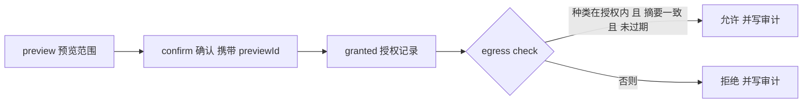

# ATS-402 ｜ AI 数据安全（AI API Key 存储、数据外传知情授权）

- WBS：ATS-402 ｜ 阶段 / 目标版本：S4 / v0.4.0 ｜ 工作流：安全 ｜ 主责：SecOps（安全与发布）
- 契约标识：`credential-store/v1` + `egress-consent/v1` + `egress-audit/v1` ｜ 实现载体：`server/security/`
- 关联要件：FR-027（多环境/密钥存储）、NFR-009（隐私保护）
- 前置依赖：ATS-401（AgentAdapter/ModelProvider 抽象及权限边界，已 `done`）
- 状态口径：本文件描述的是**已实现并经实测的凭据存储、外传授权与外传审计**。
  **模型提供商仍未接入**——仓库中没有任何代码把项目内容发往外部 AI 服务，
  因此本任务交付的是**三道闸门本身**，不是「AI 已经能读取你的项目」这一事实。

## 1. 交付范围与边界

| 属于 ATS-402（本次已实现） | 不属于 ATS-402（后续任务） |
|---|---|
| 密钥写入**系统凭据库**（Windows Credential Manager / macOS Keychain / Linux Secret Service） | 模型提供商接入、重试与回退（ATS-403） |
| 引用式落盘：索引只存引用与指纹，秘密永不进文件 | 用密钥去调用真实模型（ATS-403） |
| 外传范围预览 → 确认 → 授权记录的三步知情授权 | Reviewer 界面与 diff 审阅 UI（P1） |
| **外传审计：放行与拒绝都留痕** | 跨设备同步、云端密钥托管（P2） |
| 平台侧复算内容摘要（补上 ATS-401 §6 的缺口） | 审计记录的外部防篡改（WORM/签名，见 §7） |
| AI 数据安全界面（Next 静态导出） | Tauri 壳内的凭据存取（属 ATS-104 的 B-02 链） |

**完成定义（验收标准）的落实**：**「密钥使用系统凭据库」**与**「首次上传任何项目
内容前展示范围并确认」**这两条**已成立并有实测证据**（§5）。其中「上传」在本仓库
里**没有真实的网络出口**（没有模型提供商），所以这条完成定义的**可检验部分**是
「**外传前必须先有覆盖该内容的知情授权，闸门在平台侧强制，越权外传被拦截并留下
可核对的记录**」——它由闸门代码、API 与 UI 三层共同保证，而不是靠一条约定。

## 2. 密钥存储：系统凭据库

### 2.1 三条硬规则

| # | 规则 | 落点 | 失效时的表现 |
|---|---|---|---|
| 1 | **秘密永不落盘** | `server/security/credentials.mjs` | 索引文件里只有 `{id,name,purpose,provider,fingerprint,createdAt,updatedAt}` |
| 2 | **秘密不进 argv、不进日志** | `server/security/wincred.ps1` | 秘密经 **stdin/stdout** 传给 helper 进程；helper 的 stderr 只写错误码 |
| 3 | **凭据库不可用就拒绝** | `createCredentialStore().put()` | 抛 `CREDENTIAL_STORE_UNAVAILABLE`；**没有明文文件后端** |

第 3 条是这套设计最容易做错的地方：一个「凭据库不可用就存到 `~/.secrets`」的
回退会把前两条规则悄悄作废。因此本实现**没有**任何回退后端——`selectBackend()`
在不认识平台上返回 `null`，而 `null` 后端意味着**拒绝**。

### 2.2 平台后端

| 平台 | 后端 | 秘密的传递方式 |
|---|---|---|
| Windows | Credential Manager（advapi32 `CredWriteW`/`CredReadW`） | `server/security/wincred.ps1`，经 stdin/stdout |
| macOS | Keychain（`security` 命令行工具） | `security add-generic-password -w` 省略 `-w` 的值时从 stdin 读 |
| Linux | Secret Service（`secret-tool`） | `secret-tool store` 从 stdin 读 |

Windows 的实现细节：`CredWriteW` 的 `CredentialBlob` 是**字节**长度，秘密按
UTF-16LE 写入；`Persist = CRED_PERSIST_LOCAL_MACHINE`（只对本机有效，不随域配置
漫游）。helper 脚本在 `finally` 里把秘密所在的内存块清零后再释放。

### 2.3 指纹

引用里的 `fingerprint` 是秘密 SHA-256 的**前 8 个十六进制字符**。它的用途是让
用户核对「这是不是同一个密钥」，**不是**用来还原密钥——32 bit 的前缀不足以还原
任何有真实熵的密钥。它的存在使「界面上显示的密钥」与「凭据库里那个密钥」可以
被肉眼对齐，而不必把密钥原文取回浏览器。

## 3. 数据外传知情授权

### 3.1 三步流程



**为什么「确认」必须携带 `previewId`**：如果确认只是一个布尔值，用户确认的
范围与实际外传的范围可以是两份不同的东西——预览就成了走过场。因此：

- `previewId` 是一次性的，确认后立即作废（重复确认 → `EGRESS_PREVIEW_INVALID`）；
- 确认时**重新**计算范围摘要，与预览时的不一致 → `EGRESS_PREVIEW_STALE`；
- 授权记录里存的是**范围摘要**（种类 + ref + 内容摘要），不是内容本身。

### 3.2 授权的有效期与撤销

默认 24 小时，上限 365 天。过期后 `check()` 返回 `EGRESS_CONSENT_EXPIRED`。
撤销立即生效（`DELETE /api/security/egress/consents/:id`），撤销后的下一次
`check()` 返回 `EGRESS_CONSENT_REVOKED`。

### 3.3 判定顺序：先判定，后读取

平台侧的闸门（`server/security/egress-gate.mjs`）**先**问「这份同意书还有效吗、
它允许这些种类吗」，**再**读文件、复算摘要，**最后**问「内容与用户当时看到的
是同一份吗」。因此**没有授权时，文件内容根本不会被读进 Bridge 的内存**。

### 3.4 平台侧复算摘要（补上 ATS-401 §6 的缺口）

`docs/17-AGENT-CONTRACT.md` §6 的「未实现与后续」表里有一行：

> | 「`ref` 对应真实源内容」的构造 | ATS-402 / 平台侧 |
> | 本层只保证「摘要与内容自洽」且「`ref` 在作用域内」。平台侧读取真实文件并计算摘要的代码路径尚未实现 |

本任务的 `readScopedInput()` 就是那条代码路径：它按**项目根**做 realpath +
子路径判定，读真实文件，用**平台侧的** SHA-256 复算摘要。于是「`ref` 对应真实源
内容」这条保证不再依赖请求方声明。

路径校验与 ATS-101 的 SEC-004 同一口径：绝对路径与 `C:` 盘符一律拒绝；
符号链接指向项目外时，**realpath 之后**的路径仍须在项目根之内。

## 4. 外传审计

完成定义的第三条是「**越权外传被拦截并审计**」。拦截由闸门负责（§3），审计由
`server/security/egress-audit.mjs` 负责，两件事分开：只有拦截没有留痕，
「被拒绝了」这句话就没有可核对的依据。

| # | 规则 | 落点 |
|---|---|---|
| 1 | **成功与失败都记录** | `egress.granted` / `egress.denied` / `consent.granted` / `consent.revoked` 四类事件 |
| 2 | **记录永远不含内容** | 记录只有 `ref`、`digest`（内容 SHA-256）与字节数；`content` 与 `preview` 在**边界上**被丢弃，下游拿不到 |
| 3 | **追加写，不改写** | 撤销授权不会抹掉「曾经放行过」的记录——审计记录是**事实**，不是状态 |
| 4 | **有上限** | 500 条，超出后丢最旧的（写在代码里，不靠外部配置） |

记录持久化在 `state.json` 的 `state.egressAudit`，与授权记录共享同一次原子写，
因此不会出现「授权写了、审计没写」的中间态；跨 Bridge 重启保留（IT-AUD-004）。

**审计不是防篡改存储**：记录在本地 `state.json` 里，本机高权限进程仍可改写。
「不可篡改的审计」需要 WORM/远程归档/签名，不在本任务范围（见 §7）。

## 5. 实测证据

所有日志在 `docs/evidence/ATS-402/`，每份日志带 commit、时间戳、Node/Python
版本与实际命令。

### 5.1 单元测试（UT）

`node --test tests/security.test.mjs`：**41 项全通过，0 失败、0 跳过**
（`01-security-ut.log`）。覆盖：

- **凭据侧（15 项）**：秘密不进索引文件、引用无 `secret` 字段、指纹长度、
  字节精确回读、凭据库不可用时拒绝（且不留下索引）、索引损坏时报错而非静默清空、
  删除同时清凭据库与索引、原子写、无 `.tmp` 残留。
- **授权侧（18 项）**：无授权即拒绝、预览描述范围、预览令牌一次性、
  确认范围与预览不一致即拒、授权后只放行同一范围、内容变化即失效、
  种类超出即拒、过期即拒、撤销即拒、记录先落盘再返回。
- **审计侧（8 项）**：拒绝留痕、放行也留痕、记录落盘后才返回、
  **记录不含内容**、未知事件被拒、**追加写（撤销不抹掉过去）**、上限丢最旧、
  契约描述无密钥。

### 5.2 集成测试（IT）

`node --test tests/security-api.test.mjs`：**22 项通过、2 项跳过**
（`02-security-api-it.log`）。两项跳过的是**需要写真实凭据库**的用例
（秘密不进平台状态目录、重名即拒）。

同一套测试在 `ATS402_REAL_CREDENTIAL_STORE=1` 下：**24 项全通过，0 跳过**
（`03-security-api-it-real-store.log`），写的是**真实的 Windows Credential Manager**。

> **跳过不等于通过**：两份日志都保留，正是为了不让「跳过」把「通过」盖住。

IT 覆盖：契约端点、端点需要会话令牌、凭据清单只含引用、**秘密不出现在平台数据
目录的任何文件里**、重名即拒、非法名即拒、预览展示真实范围、**无授权外传被拒
（403）**、preview→confirm→check 放行、预览令牌不可复用、无预览的确认被拒、
**内容在确认后变化即被拒**、撤销后立即被拒、越界路径被拒（三种写法）、未知项目、
授权记录不含内容、诊断端点报告安全面、**非安全类错误保持 ATS-402 之前的行为**；
以及审计侧四项：**拒绝留痕**、**放行也留痕**、**记录不含内容**、**跨重启保留**。

### 5.3 边界探针（含负控）

`node tools/ats402-probes/probe-security-boundary.mjs`：**39 项检查全部通过**
（`04-security-boundary-probe.log`）。

探针用**四类独立信号**证明边界，每一类都带**负控**：

| 信号 | 内容 | 负控 |
|---|---|---|
| 1 **静态分析** | 五个源文件都不含「把 `secret` 写进文件 / 传成进程参数 / 写进 stderr / 打进日志」 | 对每条规则注入一个**故意写坏**的副本，要求探测器**必须报警** |
| 2 **运行期（真实凭据库）** | 秘密写入**真实** Windows Credential Manager，字节精确回读，索引文件里没有秘密 | 用一个**明文回退后端**复现同样的写入，要求检查**必须发现**泄漏 |
| 3 **运行期（外传闸门）** | 无授权即拒、内容变化即拒、越界即拒、撤销即拒；平台侧复算摘要 | 换一个「永远放行」的闸门，要求检查**必须看到差异** |
| 4 **运行期（外传审计）** | 拒绝与放行都留痕、记录不含内容、追加写、跨重启保留 | 换一个**什么都不落盘**的审计存储，要求检查**必须看到差异** |

信号 1 的探测器会**先抹掉字符串字面量**再判定：`'secret-tool'`（Linux 的
Secret Service 客户端）里含有 "secret" 这个词，但它是**工具名**不是数据流。
第一版探测器因此误报了一次——这是探针抓到的**探测器自身的缺陷**，修法与
ATS-401 的契约纯度检查一致。

### 5.4 覆盖与构建

- 全量套件：`npm test` **1259 项 / 0 失败 / 13 跳过**（`05-full-test-suite.log`）。
  13 项跳过是需要真实浏览器或真实凭据库的用例，与本任务无关。
- 类型检查：`npx tsc --noEmit`（`apps/studio`）无错，见 `12-tsc.log`。
- `next build` 成功产出 `apps/studio/out`，含新的「AI 数据安全」页签
  （`11-next-build.log`）。
- 门禁：ATS-101 端口审计、ADR 引用校验、ATS-501 协议审计、WBS 更新器共存回归、
  ATS-401 Agent 边界探针，全部通过（`06`~`10`）。
- WBS 行：`tools/wbs_ats402_row_check.py` 读回**已提交的工作簿**并核对
  ATS-402 行 = 待审核 / 完成率 1 / 剩余人日 0，且备注带 `【ATS-402】` 标记、
  写明三个契约标识与未实现的 ATS-403（`13-wbs-ats402-row.log`）。

### 5.5 界面实测

**本任务未做浏览器实测。** 上一轮曾计划驱动真实浏览器（Edge headless）并留下
截图，但那份证据从未采集，因此本文件**不引用**任何截图，也不声称界面已实机
验证。已验证的是：Next 静态导出**构建成功**（`11-next-build.log`），且
`npx tsc --noEmit` 无错。界面上的每一条路径都有对应的 IT 覆盖（§5.2），
但**界面本身的交互未在真实浏览器里点过**——这是 §8 的未验证项。

## 6. API 面

| 方法 | 路径 | 鉴权 | 说明 |
|---|---|---|---|
| GET | `/api/security/contract` | token | 凭据库、外传授权与外传审计的契约描述（后端名、错误码、流程） |
| GET | `/api/security/credentials` | token | 凭据**引用**清单（**没有**返回密钥的接口） |
| POST | `/api/security/credentials` | token | 把密钥存入系统凭据库，返回引用 |
| GET | `/api/security/credentials/:id` | token | 单个引用 |
| DELETE | `/api/security/credentials/:id` | token | 删除凭据库条目与引用 |
| POST | `/api/security/egress/preview` | token | 展示将要外传的范围（平台侧读真实文件并复算摘要） |
| POST | `/api/security/egress/confirm` | token | 确认预览，生成授权记录 |
| GET | `/api/security/egress/consents` | token | 授权记录清单 |
| DELETE | `/api/security/egress/consents/:id` | token | 撤销授权（立即生效） |
| POST | `/api/security/egress/check` | token | 闸门本身：判定这些输入能否外传（放行与拒绝都写审计） |
| GET | `/api/security/egress/audit` | token | 外传审计记录（只含 ref/字节数/摘要，不含内容） |

错误码：`CREDENTIAL_*`（6 个）与 `EGRESS_*`（9 个，含 `EGRESS_AUDIT_EVENT_INVALID`）
是稳定契约，调用方按 `err.code` 分支。`server/index.mjs` 把它们映射为 **400**
（`NOT_FOUND` → 404，`UNAVAILABLE`/`FAILED` → 503），**且只影响这两个前缀**——
其它错误保持 ATS-402 之前的行为不变（IT-SEC-018 专门验证了这一点）。

## 7. 未实现与后续

| 项 | 归属 | 说明 |
|---|---|---|
| 模型提供商接入、重试与回退 | ATS-403 | 本仓库**没有**任何代码把项目内容发往外部 AI 服务 |
| Tauri 壳内的凭据存取 | ATS-104（B-02 链） | `src-tauri/src/lib.rs` 仍只有 `local_bridge_status`；**Rust 侧改动未验证**（见 §8） |
| 跨设备同步、云端密钥托管 | P2 | 不在本任务范围 |
| 审计记录的外部防篡改（WORM/签名/远程归档） | P2 | 审计记录在本地 `state.json` 里，本机高权限可改写 |
| 授权的「重新确认」提醒 | P1 | 当前只在到期/撤销时失效，没有主动提醒 |
| Reviewer 界面与 diff 审阅 | P1 | 授权记录已就绪，评审界面未实现 |
| 用密钥调用真实模型 | ATS-403 | 本任务只交付**存取**与**闸门** |

**不得声称的能力**：仓库中没有任何代码把项目内容发往外部 AI 服务。FR-027 与
NFR-009 的**存储**与**授权**部分已实现；「AI 能读取你的项目」这一事实**未实现**。

## 8. 未验证项声明（PENDING ≠ PASS）

1. **Tauri 侧未验证**：`src-tauri/src/lib.rs` **未改动**，因此本任务不依赖它；
   但也因此**没有**在 Tauri 壳内验证凭据存取。该链的阻断是 ATS-101 的 **B-02**
   （本机 `cargo check`/`cargo build` 均因 `link.exe` 解析到 GNU coreutils 而失败，
   详见 `docs/16-BASELINE-ADR.md` §4 B-02）。
2. **macOS / Linux 后端未实测**：本机是 Windows 11，Keychain 与 Secret Service
   两个后端的代码路径**未在真机执行过**。它们与 Windows 后端共用同一套
   「stdin/stdout 传秘密」的接口形状，但**未经实机验证**。
3. **真实模型外传未验证**：没有模型提供商，因此「授权后内容真的被发出去」这条
   链路**没有端到端证据**。已验证的是**闸门**：没有授权时被拒、有授权且范围
   一致时被放行，且两种判定都留下审计记录。
4. **界面未实机验证**：「AI 数据安全」页签**没有**在真实浏览器里点过，
   没有截图证据（见 §5.5）。已验证的是静态导出构建成功与类型检查无错。
5. **ST 未执行**：本任务的验收方式是 IT,ST。**ST 未执行**——ST-031/032/033
   （密钥入库后不在本机可读文件 / 首次外传前必须展示范围并确认 / 无授权的外传
   请求被拒）依赖真实外发与人工确认，本仓库无外发路径，三条仍为 **PENDING**
   （`docs/09-ST-TEST-DESIGN.md`）。
6. **审计的防篡改性未验证**：审计记录在本地 `state.json`，本机高权限进程可改写；
   本任务只验证了「有记录、内容不在记录里、跨重启保留」，**没有**验证不可篡改。

## 9. 复现命令

```bash
# 单元测试
node --test tests/security.test.mjs

# 集成测试（两项真实凭据库用例会跳过）
node --test tests/security-api.test.mjs

# 集成测试（真实 Windows Credential Manager）
ATS402_REAL_CREDENTIAL_STORE=1 node --test tests/security-api.test.mjs

# 边界探针（含负控）
node tools/ats402-probes/probe-security-boundary.mjs

# WBS 行同步
python tools/update_wbs_ats402.py

# 全部证据一次收集
bash tools/ats402-probes/collect-evidence.sh
```

探针的中间产物落在 `$TMPDIR/ats402-probes`（可用 `ATS_PROBE_WORKDIR` 覆盖），
不进版本控制。
